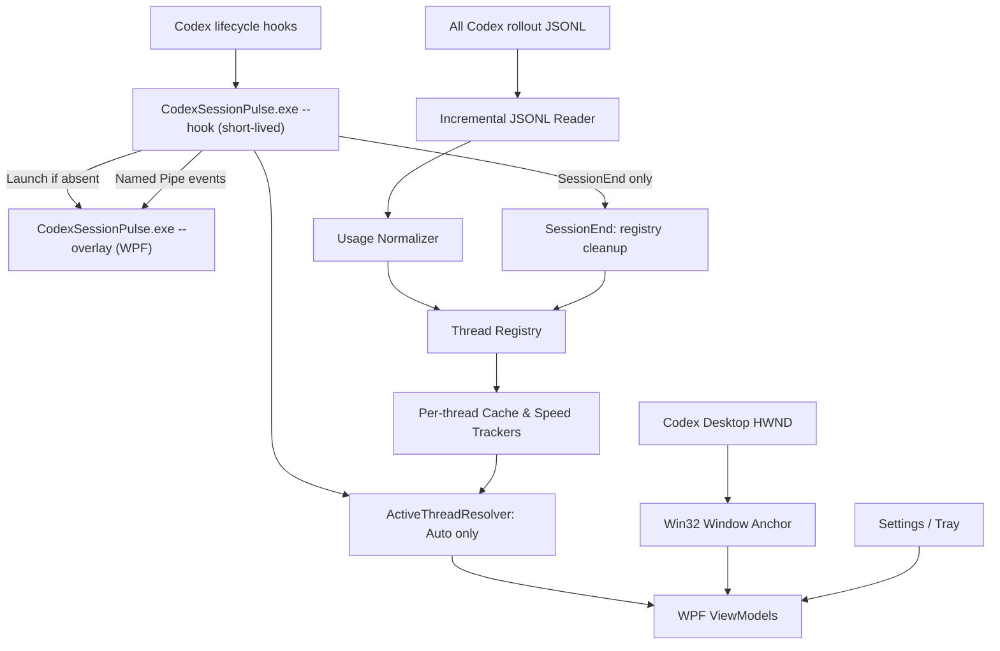

# Codex Session Pulse — спецификация WPF и Win32

Источник требований для issues #249–#254. PRD — [prd.md](prd.md).

**Версия:** 1.3 · **Дата:** 5 ноября 2026 · **Платформа:** Windows 11 · **Стек:** C# / .NET 10 / WPF / Win32 Interop

**Цель:** отдельное Windows-приложение, которое показывает компактный оверлей над окном Codex Desktop: состояние prompt cache, приблизительное оставшееся время, объём повторно использованных токенов и скорость генерации. Приложение не модифицирует Codex Desktop и по умолчанию ничего не отправляет в сеть.

**Ключевое архитектурное решение:** все hooks вызывают **один бинарник** `CodexSessionPulse.exe` в быстром режиме `--hook`; он передаёт события уже запущенному экземпляру или запускает тот же EXE в долгоживущем режиме `--overlay`. Путь `--hook` не загружает WPF и укладывается в тёплый старт ≤150 мс (§4.4 п. 1); `SessionStart` и `UserPromptSubmit` объявлены `async`, чтобы Codex его не ждал. Hooks — усилитель, а не фундамент: без них overlay работает по JSONL в режиме `Auto · inferred` и запускается вручную (§4.4 п. 7). `Named Mutex` гарантирует единственный WPF-процесс, а Named Pipe переносит события. `SessionEnd` удаляет завершённый main thread из горячего `ThreadRegistry`, но **не запускает** overlay и не завершает его. WPF самостоятельно завершает работу после закрытия последнего окна Codex. Процесс ведёт независимые метрики по `threadId`, выбирает отображаемый thread **только автоматически** и читает локальные `rollout-*.jsonl` в режиме read-only. Отдельных Launcher.exe/Monitor.exe и ручного `Pinned`/выбора сессии нет. `Auto Warm` — отдельная экспериментальная функция, выключенная по умолчанию.

> **Кэш сервера нельзя наблюдать напрямую.** Логи дают фактические `cachedInputTokens` для завершённых запросов, но не точную дату удаления записи на стороне OpenAI. Поэтому таймер обязательно маркируется **Estimate** / «оценка»; сам факт попадания в кэш показывается отдельно от прогноза TTL. Нельзя представлять прогноз как гарантированное время жизни.

## 1. Контекст и исходные данные

### 1.1 Функциональный аналог

Основа логики — собственный плагин [Session Pulse для Claude Code](https://github.com/dlin10/ai-coding-plugins/tree/main/mods/session-pulse):

- `hooks/register.tsx`: сбор событий и UI, модель данных, Auto Warm;
- `hooks/format.ts`: форматирование значений;
- `tests/session-pulse.test.tsx`: сценарии времени, повторного использования и обновления;
- `types/index.d.ts`: контракты плагина.

Из Claude-плагина берём принципы: отслеживание **основного thread** без смешивания с subagents, фактических cache hits, оставшегося времени и средневзвешенной скорости; отделение Auto Warm от основного диалога; независимое тестирование часов. API хуков Claude не копируем: в Codex есть lifecycle hooks `SessionStart`/`UserPromptSubmit`, но нет документированного hook для каждого переключения вкладки Desktop.

### 1.2 Подтверждённый образец Codex

В полученном пользователем фрагменте JSONL встречались следующие завершённые запросы:

| **UTC** | **Input** | **Cached** | **CacheWrite** | **Output** |
|---|---|---|---|---|
| 2026-11-02 13:22:14 | 239071 | 235392 | 0 | 274 |
| 2026-11-02 13:22:58 | 240392 | 239104 | 0 | 961 |
| 2026-11-02 13:23:07 | 242386 | 241152 | 0 | 283 |
| 2026-11-02 13:23:17 | 244157 | 242432 | 0 | 218 |
| 2026-11-02 13:32:02 | 245349 | 245120 | 0 | 26328 |

Для последнего запроса `245120 / 245349 ≈ 99.91%` входных токенов были прочитаны из кэша. `CacheWrite = 0` **не** означает отсутствие кэша. Значение `Output` может включать reasoning-токены; оно не равно длине видимого текста.

### 1.3 Проверяемые интерфейсы

- Локальные Codex rollouts обычно доступны в `%USERPROFILE%\.codex\sessions\**\rollout-*.jsonl` (точный корень и схема должны определяться во время запуска).
- В протоколе Codex app-server есть `thread/tokenUsage/updated` с `tokenUsage.last` и `tokenUsage.total`, в том числе `cachedInputTokens` и `cacheWriteInputTokens` ([схема](https://github.com/openai/codex/blob/main/codex-rs/app-server-protocol/schema/json/v2/ThreadTokenUsageUpdatedNotification.json)). Это полезный **дополнительный** канал для собственного app-server, но не гарантия подключения к уже запущенному Desktop.
- В протоколе также присутствует `thread/fork` с параметром `ephemeral` ([схема](https://github.com/openai/codex/blob/main/codex-rs/app-server-protocol/schema/json/v2/ThreadForkParams.json)). Это кандидат для Auto Warm, но его совместимость с кэшем **существующего** Desktop-потока нужно проверить экспериментально.
- [Codex Hooks](https://learn.chatgpt.com/docs/hooks) поддерживают `SessionStart` (`source` ∈ `startup|resume|clear|compact|fork`), `UserPromptSubmit` и `SessionEnd`. Каждый command hook получает в stdin JSON с `session_id`, `transcript_path` (string | null), `cwd`, `hook_event_name`, `model`; `SessionStart` добавляет `source`, `UserPromptSubmit` — `turn_id`, `prompt` (полный текст, потенциально сотни килобайт) и `permission_mode`, `SessionEnd` — `reason`. По умолчанию Codex ждёт завершения command hook; `"async": true` снимает ожидание (до 8 фоновых одновременно), но `SessionEnd` всегда синхронен, его timeout по умолчанию 1 с и не больше 3 с. Для Windows команда задаётся полем `commandWindows`; в каком shell она выполняется, официально не документировано (plan-forge-flow измерил: обнаруженный shell пользователя либо `cmd.exe`). `SessionEnd` вызывается для main thread, в том числе при архивировании/удалении, нормальном закрытии Codex или после 30 минут неактивности при отсутствии подключённых клиентов; это **не** сигнал закрытия последнего окна. Hooks привязаны к lifecycle сессии, не к фокусу вкладки приложения. Hooks плагина проходят trust review, и доверие записано по хэшу hook: обновление плагина, меняющее его файлы, снова требует Review hooks, а до этого hook пропускается с одним предупреждением при старте. Hooks можно отключить целиком (`[features] hooks = false`, `allow_managed_hooks_only`).
- [Codex App Server](https://learn.chatgpt.com/docs/app-server) различает `thread.id` и `thread.sessionId`: fork-потоки могут иметь общий корневой `sessionId`. Поэтому ключом cache state служит `threadId` / уникальная identity rollout, **не один** `session_id`**hook**.
- [Официальная документация Prompt caching](https://developers.openai.com/api/docs/guides/prompt-caching) описывает измерение cache hits и текущие варианты удержания кэша. API-настройки не следует автоматически приписывать внутренним запросам Codex Desktop.

## 2. Область проекта

### 2.1 Входит в MVP (P0)

1. Самостоятельное Windows-приложение без внедрения DLL, патчинга Electron/JS и модификации Codex.
2. Автоматическое обнаружение foreground-окна Codex; позиционирование оверлея относительно него, включая перемещение и DPI.
3. Наблюдение за **всеми локальными main threads** через JSONL с отдельным состоянием для каждого `threadId`.
4. Показ фактического последнего cache hit, cached/input, предполагаемого TTL и статуса источника данных.
5. Hooks `SessionStart`/`UserPromptSubmit` (`async`) → быстрый `CodexSessionPulse.exe --hook` без загрузки WPF → один `CodexSessionPulse.exe --overlay`; `SessionEnd` (`timeout: 3`) → очистка соответствующего main thread из registry без запуска overlay. WPF самостоятельно закрывается после последнего окна Codex. Один EXE, без отдельного hook-бинаря и постоянного Windows-монитора; cmd-launcher в `bin/` по конвенции репозитория (§4.2) вторым бинарём не считается. Overlay работает и без hooks: автоселект по JSONL даёт `Auto · inferred`, ручной запуск `--overlay` — штатный путь.
6. **Только Auto:** автоматический ActiveThreadResolver по hooks и активности; отсутствие ручного выбора или фиксации thread. При неопределённости явно показывать `Auto · inferred`.
7. Настройки, трей и диагностика без текстов диалогов; Unit/интеграционные тесты и framework-dependent релиз Windows x64 (.NET 10 Desktop Runtime), поставляемый как release asset через каталог репозитория (§4.2, §10).

### 2.2 После MVP (P1)

- Дополнительное сопоставление активной вкладки и `threadId` с помощью Windows UI Automation, если прототип подтверждает стабильность этого сигнала.
- Скорость генерации, если получены достоверные временные границы фактической генерации; иначе явно помеченная оценка/`—`.
- Уведомление при падении cache-hit rate и расширенная история событий.
- Опциональный режим «клик насквозь» без интерактивных кнопок.

### 2.3 Эксперимент (P2)

`Auto Warm`: отдельный изолированный model-request, способный переиспользовать тот же cache prefix, **если доказан реальный cache hit**. До успешного spike кнопка отображается отключённой с подсказкой `Experimental — not validated` либо скрывается настройкой.

### 2.4 Не входит

- Получение «точного TTL», которого нет в логах.
- Модификация или инъекция в процесс Codex Desktop.
- Перехват авторизационных токенов, приватных API, сетевого трафика или обход механизмов доступа.
- Редактирование `rollout-*.jsonl` или содержимого основной сессии.
- Требование подключения к OpenAI API с отдельной оплатой для обычного мониторинга.
- Ручной переключатель `Auto / Pinned`, выпадающий список сессий и сохранение `pinnedSessionId`.

## 3. Внешний вид и поведение

### 3.1 Основная строка

Визуальный ориентир — существующий Session Pulse: компактная строка у нижнего края Codex Desktop с минимальной высотой, без заголовка окна. Показанные cache/TTL/speed всегда принадлежат **одному автоматически определённому thread**, другие threads продолжают отслеживаться независимо.

`cache [████████░░░] ~24 min · 245.1k/245.3k · Avg speed — [Auto Warm]`

Отображаемые элементы:

| **Элемент** | **Семантика** | **Действие** |
|---|---|---|
| `cache` | Состояние последнего запроса | Наведение: временная отметка UTC/local, модель (если известна), source и confidence |
| Полоса | `remaining / configuredTtl`, только прогноз | Цвет зависит от состояния; неизвестный TTL = серый indefinite |
| `~24 min` | Расчётное время до предполагаемого истечения | Тильда обязательна для оценки; `TTL unknown` при отсутствии достаточных данных |
| `245.1k/245.3k` | Cached / input последнего запроса | Tooltip с процентом и cacheWrite |
| `Avg speed` | Средняя скорость в токенах/сек. только при наличии времён | Иначе `—`, tooltip «Timing data unavailable» |
| `Auto Warm` | Опциональное продление | Disabled до отдельной валидации; после включения — явный opt-in |

Текст `Auto · confirmed` (или ненавязчивый tooltip) означает, что текущий thread подтверждён hook-сигналом; `Auto · inferred` — выбран по последнему достоверному событию, но фактическая выбранная вкладка может отличаться. Никакого ручного thread selector в UI нет. `Auto` здесь — режим выбора отображаемого thread, **не** опция `Auto Warm`.

Размеры ориентировочные: высота 36–44 DIP, ширина 500–900 DIP (адаптивно), скругление 10 DIP, внутренние отступы 8–12 DIP, шрифт Segoe UI 12–13 pt, полоска 6–10 DIP. Тема светлая/тёмная через системные параметры, можно принудительно выбрать тему. Не перекрывать ввод: базовая позиция **над областью ввода или на несколько DIP выше нижнего края клиентской области**, с ручным смещением.

### 3.2 Состояния

| **State** | **Когда** | **Что показывать** |
|---|---|---|
| `NoSession` | JSONL не найден | `Codex session not found`; кнопка Choose folder |
| `WaitingForUsage` | Сессия есть, `token_count` ещё нет | `Waiting for token usage…` |
| `Warm` | Последнее наблюдение подтверждает cache hit достаточного размера | Синяя/зелёная полоска + оценка времени |
| `ExpiringSoon` | Остаток <= 25% оценочного TTL | Оранжевый + tooltip «Estimated» |
| `EstimatedExpired` | Оценка TTL прошла без нового наблюдения | Серый `Cache may have expired`; не утверждать miss |
| `ObservedMiss` | Новый запрос подтвердил сильное падение cache reuse относительно сопоставимого prefix | Красный `Observed cache miss`, timestamp |
| `Stale` | Данные давно не обновлялись / файл недоступен | Серый `Last update HH:mm` |
| `Error` | Сбой watcher/parser | Ненавязчивый значок + диагностическая карточка |

`ObservedMiss` не выводится из одного `cacheWrite = 0`, одного нулевого cache read на маленьком prompt или обычного изменения модели. Переходы при невозможности сопоставить префиксы дают `Unknown`.

### 3.3 Привязка к окну

- Автоматически прикреплять оверлей к foreground-окну Codex; сохранять process/window identity для восстановления привязки, но не хранить устаревший HWND навечно.
- **Что считается окном Codex.** Desktop — Electron-приложение (класс окна `Chrome_WidgetWin_1`); имя процесса по отчётам пользователей разное (`Codex.exe` в сборке из Microsoft Store, `ChatGPT.exe` в других), окон может быть несколько («secondary app windows» в changelog). Правило P0: окно Codex — видимое top-level окно процесса, имя которого входит в настраиваемый список `codexProcessNames` (по умолчанию `Codex`, `ChatGPT`) и которое проходит настраиваемый фильтр заголовка `codexWindowTitleFilter` (по умолчанию пустой). Все такие окна учитываются при решении «последнее окно закрыто». Имя процесса, класс, шаблон заголовка и число окон измеряются в Шаге 0 (§12); если приложение общее с ChatGPT, правило уточняется по результатам. «Окно не найдено» — отдельное диагностическое состояние с подсказкой про настройку, не `Error`.
- При перемещении, изменении размера, изменении DPI и переносе между мониторами оверлей пересчитывает позицию.
- Когда целевое окно свернуто, закрыто, неактивно или находится за другим приложением, оверлей скрыт по умолчанию. Опция `Keep visible when Codex is not focused` доступна, но `Topmost` не должен мешать другим приложениям.
- Размер и позиция ограничиваются рабочей областью текущего монитора. Не перекрывать системные панели и диалоги.
- При нескольких окнах Codex `WindowAnchor` следует за foreground-окном, а `ActiveThreadResolver` независимо определяет thread по hooks. **Нельзя** считать foreground HWND доказательством выбора конкретной вкладки. При отсутствии достоверного сигнала оставлять последний наблюдаемый thread с `Auto · inferred`, не выдавая его за подтверждённо активный. При двух и более окнах Codex confidence не выше `inferred`; дешёвое усиление без UI Automation — сопоставление `cwd` из hook с заголовком окна, если Desktop выводит проект в title (проверить в Шаге 0).

## 4. Архитектура

### 4.1 Модули



Независимые контракты: reader не знает WPF, tracker не знает расположения файлов, UI получает immutable snapshot. Движок не должен зависеть от конкретного имени процесса Desktop: окно распознаётся по настраиваемому правилу §3.3.

### 4.2 Структура в монорепо

Плагин живёт в монорепо `dlin10/ai-coding-plugins` как `plugins/codex-session-pulse/`, по конвенциям соседних .NET-плагинов (`roslyn-mcp`, `plan-forge-flow`, `cache-detective`); отдельного репозитория нет. Имя `session-pulse` занято Claude-модом в `.claude-plugin/marketplace.json`, поэтому плагин называется `codex-session-pulse`.

```text
plugins/codex-session-pulse/
  .codex-plugin/plugin.json          # единственный host-манифест: Codex-only плагин
  hooks/hooks.json                   # SessionStart, UserPromptSubmit, SessionEnd (commandWindows)
  bin/
    codex-session-pulse-launcher.cmd # находит EXE версии плагина (или скачивает его) и запускает
    codex-session-pulse-cache.ps1    # release asset -> %LOCALAPPDATA%\CodexSessionPulse\bin\<version>\
  src/
    CodexSessionPulse.App/           # единственный WinExe: --hook / --overlay, WPF, tray, DI
    CodexSessionPulse.Core/          # domain, trackers, clocks, state
    CodexSessionPulse.Infrastructure/# JSONL tailer, settings, filesystem
    CodexSessionPulse.Win32/         # HWND, hooks, DPI, monitor geometry
  tests/
    CodexSessionPulse.Core.Tests/
    CodexSessionPulse.Infrastructure.Tests/
    CodexSessionPulse.Win32.Tests/   # Windows integration / opt-in
  docs/
    spec.md                          # этот файл
    prd.md
    compatibility.md                 # результаты Шага 0
    adr/
  AGENTS.md, README.md (версия в заголовке), CHANGELOG.md, CONTEXT.md
  CodexSessionPulse.slnx, Directory.Build.props, global.json
```

Регистрация — запись в `.agents/plugins/marketplace.json` (`source: local`, `path: ./plugins/codex-session-pulse`); в Claude- и Cursor-каталоги плагин не входит, `npm run validate:plugins` это допускает. Корневой README получает секцию рядом с модом `session-pulse` с перекрёстной ссылкой. CI — `.github/workflows/build-codex-session-pulse.yml` на `windows-latest`, релиз — `release-codex-session-pulse.yml`, по образцу `build-roslyn-mcp.yml` и `release-roslyn-mcp.yml`. EXE в git не хранится: Codex держит копию плагина на каждую версию (`~/.codex/plugins/cache/<marketplace>/<plugin>/<version>`), поэтому бинарь — GitHub Release asset `codex-session-pulse-v<version>/CodexSessionPulse.exe`, который launcher скачивает при первом запуске (ADR 0008 roslyn-mcp). Быстрый путь launcher — `if exist "%EXE%"` в `cmd.exe` без PowerShell; помощник на PowerShell вызывается только когда EXE этой версии ещё нет, иначе бюджет тёплого старта hook не выполнить.

Желательные зависимости: `Microsoft.Extensions.Hosting`, `Microsoft.Extensions.DependencyInjection`, `Microsoft.Extensions.Options`, `Microsoft.Extensions.Logging`, `System.Text.Json`; тесты xUnit + FluentAssertions (или чистый xUnit); WPF с MVVM через `CommunityToolkit.Mvvm` либо минимальные собственные viewmodels. Трей — поддерживаемый Win32/Shell NotifyIcon API либо изолированный адаптер WinForms `NotifyIcon`; WinForms допустим **только для трея**, не для рендеринга оверлея. Не добавлять тяжёлую UI-библиотеку ради одной строки.

### 4.3 Предлагаемые интерфейсы

```csharp
public readonly record struct TokenUsageSnapshot(
    DateTimeOffset ObservedAtUtc,
    string ThreadId,
    string? RootSessionId,
    string? TurnId,
    string? Model,
    long InputTokens,
    long CachedInputTokens,
    long? CacheWriteInputTokens,
    long OutputTokens,
    long? ReasoningOutputTokens,
    string SourcePath,
    long EventSequence);

public interface ISessionEventSource : IAsyncDisposable
{
    IAsyncEnumerable<TokenUsageSnapshot> WatchAsync(CancellationToken ct);
}

public interface ICacheTracker
{
    CacheSnapshot Apply(TokenUsageSnapshot usage);
    CacheSnapshot Tick(DateTimeOffset nowUtc);
}

public interface IWindowAnchor : IAsyncDisposable
{
    IObservable<AnchorSnapshot> Snapshots { get; }
    void Attach(nint hwnd);
}

public interface IClock { DateTimeOffset UtcNow { get; } }
```

`ThreadRegistry` — `ConcurrentDictionary<string, ThreadPulseState>` с независимыми `CacheTracker`, `SpeedTracker`, моделью, `LastActivityUtc` и lifecycle generation на каждый main thread. Когда thread ID отсутствует, временным ключом служит нормализованный уникальный rollout path; после корреляции выполняется безопасное слияние без повторной обработки usage. `SessionEnd` адресно удаляет main thread и освобождает его ресурсы; bounded tombstones завершённых thread/rollout identities не позволяют discovery старых JSONL немедленно вернуть удалённое состояние. Новое `SessionStart`/`resume` или подтверждённая новая активность снимает tombstone. Типы `CacheSnapshot`, `AnchorSnapshot` должны содержать display state, confidence, diagnostics, timestamp и числовые поля, не вычислять форматированные строки внутри core. Контракт снимка для UI фиксируется до начала UI-работ, чтобы оверлей строился на стабе параллельно с процессной частью: `threadId`, `kind` (main/fork/subagent), `selection` (confirmed/inferred/unknown и причина), `lastRequestAt`, `cachedInput`, `input`, `cacheRatio`, `ttl {estimate?, basis}`, `speed?` (в P0 всегда отсутствует и показывается как «—»), `source {status, path?, cliVersion}`, `codexWindows` (число найденных окон).

### 4.4 Автозапуск, завершение и выбор thread

1. Локально установленный и доверенный Codex hook `SessionStart` (все `source`: `startup`, `resume`, `clear`, `compact`, `fork` — matcher не ставится, `source` передаётся в overlay) запускает **тот же** `CodexSessionPulse.exe --hook`. Это быстрый bootstrap-путь в `[STAThread] Main`: **до инициализации WPF** прочитать JSON из stdin (`hook_event_name`, `session_id`, `transcript_path`, `cwd`, а также `source`/`turn_id`/`reason`, если присутствуют), определить наличие overlay и передать событие через локальный Named Pipe. Требования к пути `--hook`: (а) он не загружает `PresentationFramework`/`PresentationCore` — никаких WPF-типов в статике `Program`, проверяется тестом по списку загруженных сборок; (б) тёплый старт процесса до exit ≤150 мс, холодный измеряется в Шаге 0 и записывается в `compatibility.md`; если порог не достигается, записанный запасной вариант — отдельный маленький hook-бинарь в том же релизе, и это решение принимается явно, не молча; (в) stdin читается с лимитом (например, 1 МиБ) потоковым парсером, берутся только нужные поля, `prompt` целиком не материализуется, обрезанный JSON не валит процесс, stdin никогда не попадает в диагностику; (г) ничего не читается по относительным путям и из `cwd` — это репозиторий пользователя, возможно недоверенный. Если overlay отсутствует, запустить **тот же EXE** с `--overlay`, дождаться доступности pipe в ограниченный срок (connect ≤300 мс) и завершить `--hook` с exit code 0; при неуспехе — тоже exit 0 и запись в собственный лог, JSONL остаётся резервным источником. Долгоживущий WPF-процесс **никогда не исполняется непосредственно внутри hook**: Codex ждёт завершения синхронной команды, а background hooks ограничены timeout/cancellation. Отдельных `PulseLauncher.exe` или `Monitor.exe` нет.
2. `--overlay` удерживает именованный `Mutex` в `Local\\` (например, `Local\\CodexSessionPulse.<SID>.<major>`), атомарно обеспечивая **один WPF-процесс** при одновременных hooks. Если процесс уже существует, новый bootstrap отправляет событие ему по Named Pipe; `Process.GetProcessesByName` не служит единственным механизмом singleton. Pipe создаётся с `PipeOptions.CurrentUserOnly`, имя включает SID пользователя и мажорную версию протокола (как в ADR 0004 roslyn-mcp), чтобы два установленных релиза не делили канал. Числа: connect ≤300 мс, запись события ≤200 мс, bounded retry при гонке cold start, Codex надолго не блокируется. Обязательный сценарий: `UserPromptSubmit` пришёл раньше, чем свежезапущенный overlay открыл pipe — hook ждёт в пределах бюджета, затем завершается с exit 0, а overlay при старте перечитывает хвост JSONL, так что потеря события безвредна. `UserPromptSubmit` передаёт метаданные аналогично. Не возвращать текст prompt в hook output и не передавать содержание диалога через IPC. При сбое pipe hook завершается безопасно; JSONL discovery остаётся резервным источником состояния.
3. `ActiveThreadResolver` работает **всегда в Auto**. Приоритет: подтверждённый `threadId` из verified UI Automation (только если реализована) > thread из hook пользовательской активности > `SessionStart`/`resume` > последняя локальная активность из JSONL. Последний вариант является inference; фоновый subagent usage не должен перехватывать display. События должны коррелировать с `transcript_path`/thread metadata, потому что hook `session_id` не уникален для forks.
4. Переключение вкладки без отправки запроса может не породить hook. P0 тогда отображает `Auto · inferred` и данные последнего наблюдаемого thread; не обещать абсолютную точность выбора UI tab. Пользователь не может вручную pin/select thread. В P1 проверить UI Automation и её стабильность между обновлениями Codex Desktop.
5. **Завершение overlay независимо от parent PID.** Обычный дочерний процесс в Windows переживает родителя, но процесс внутри job object с `JOB_OBJECT_LIMIT_KILL_ON_JOB_CLOSE` завершается вместе с job. Codex кладёт дочерние процессы MCP-серверов именно в такой job (ADR 0004 roslyn-mcp: limit flags `0x2000`, breakaway запрещён; Codex Desktop закрывает job при закрытии треда, #217). Запускаются ли так же hook-процессы — измеряется в Шаге 0 (`IsProcessInJob`, `QueryInformationJobObject` из `--hook`; судьба его потомка после закрытия треда и окна). Если да, overlay нельзя стартовать как простого потомка hook: применить паттерн запуска из ADR 0004/0010 roslyn-mcp и честно показывать `exitsWithJob` в диагностике там, где job breakaway не разрешает; штатный ручной запуск `--overlay` (п. 7) остаётся рабочим путём в любом случае. `WindowLifetimeMonitor` отслеживает `EVENT_OBJECT_DESTROY`/`SetWinEventHook`, проверяет актуальные top-level окна через `EnumWindows` и process/window identity. После закрытия **последнего** окна Codex выждать grace period 3–5 секунд, повторно проверить и вызвать `Application.Current.Shutdown()`. Свернутое/неактивное окно не считается закрытым. Закрытие отдельного thread или `SessionEnd` **не** завершает WPF; следующий `SessionStart` снова запустит `--overlay`. Стартовый экран Codex без сессии не обязан автоматически запускать overlay.
6. `SessionEnd` вызывает **только** `CodexSessionPulse.exe --hook` в режиме `cleanup-only`: если Named Pipe/overlay отсутствует, сразу завершиться, ничего не создавая. Hook синхронный, `timeout: 3` (максимум, который допускает Codex); доставка укладывается в connect ≤300 мс + запись ≤200 мс, остаток — запас на старт процесса. По метаданным hook (`session_id`, `transcript_path`) сопоставить **точно один main thread**; не удалять все forks по общему root session ID. Идемпотентно отметить его `Ended`, удалить state из активного `ThreadRegistry`, отписать file watcher/tailer там, где подписка принадлежит только этому thread, освободить trackers и перезапустить Auto-выбор другого наблюдаемого thread. Дубли и неизвестные `SessionEnd` — no-op. Учесть возможную задержку/перестановку событий: более новая `SessionStart`/активность не должна уничтожаться устаревшим cleanup; использовать корреляцию identity, timestamps/generation и сериализацию событий на стороне overlay. Хранить ограниченные tombstones, чтобы сканирование старых JSONL не восстанавливало завершённый thread до новой активности. Периодическая bounded-pruning очистка обрабатывает пропущенные `SessionEnd` после crash/disabled hooks, без удаления подтверждённо активных сессий.
7. Все hooks запускаются только в поддерживаемом локальном Windows execution environment и требуют trust review. Доверие записано по хэшу hook, поэтому **каждый релиз плагина** (бамп версии меняет файлы плагина) снова требует Review hooks; до него hooks пропускаются, Codex показывает лишь предупреждение при старте. Это штатное состояние после каждого обновления, а не редкий корпоративный случай, поэтому: overlay работает по JSONL без hooks в режиме `Auto · inferred`; ручной запуск `--overlay` (ярлык, трей, команда из README) — поддерживаемый путь, не только диагностический; в диагностике и tooltip виден счётчик hook-событий с момента старта и подсказка «hooks не наблюдаются — после обновления плагина откройте Review hooks», когда счётчик нулевой при активных JSONL. Если hooks отключены организационной политикой — то же поведение. Ручного выбора thread это не вводит. На Windows отдельно проверить stdin у GUI/WinExe процесса, quoting и процессное окружение запуска hook.

Пример `hooks/hooks.json` (quoting WinExe и stdin проверить в Windows spike; `SessionEnd` синхронен независимо от `async`; `command` для не-Windows — `exit 0`, как у соседних плагинов):

```json
{
  "hooks": {
    "SessionStart": [{
      "hooks": [{ "type": "command", "command": "exit 0", "commandWindows": "cmd.exe /d /c \"${PLUGIN_ROOT}\\bin\\codex-session-pulse-launcher.cmd\" --hook", "async": true, "timeout": 60 }]
    }],
    "UserPromptSubmit": [{
      "hooks": [{ "type": "command", "command": "exit 0", "commandWindows": "cmd.exe /d /c \"${PLUGIN_ROOT}\\bin\\codex-session-pulse-launcher.cmd\" --hook", "async": true, "timeout": 10 }]
    }],
    "SessionEnd": [{
      "hooks": [{ "type": "command", "command": "exit 0", "commandWindows": "cmd.exe /d /c \"${PLUGIN_ROOT}\\bin\\codex-session-pulse-launcher.cmd\" --hook --no-start", "timeout": 3 }]
    }]
  }
}
```

Matcher на `SessionStart` не ставится: `fork`, `clear` и `compact` нужны и измерениям Шага 0, и `ActiveThreadResolver`. Таймаут 60 с на async-`SessionStart` покрывает первый запуск, когда launcher скачивает EXE (скачивание идёт во временный файл с переименованием, как в ADR 0008, так что прерванная загрузка не оставляет битого EXE); `UserPromptSubmit` получает 10 с; при `async` Codex их не ждёт. `SessionEnd` получает 3 с — максимум, который допускает Codex.

## 5. Чтение JSONL и автоматическая идентификация thread

### 5.1 Источник

По умолчанию искать корень под профилем пользователя: `Path.Combine(Environment.GetFolderPath(SpecialFolder.UserProfile), ".codex", "sessions")`. Допускать override в настройках; поддержать пользовательский `CODEX_HOME`, если Codex действительно использует его в текущем окружении. Не сканировать всю файловую систему.

В каждом `rollout-*.jsonl` искать события `type == "event_msg"`, `payload.type == "token_count"`, `payload.info.last_token_usage`. В отдельных версиях допустим snake_case / camelCase для полей; реализовать явные адаптеры и fixture tests. `total_token_usage` не использовать как per-request, иначе будут двойные подсчёты. В 0.162 сторонние разборы отмечают верхнеуровневый тип `token_usage_record` — что это и дублирует ли он `token_count`, выясняет Шаг 0. `cli_version` из `session_meta` (в Desktop может отличаться от установленной CLI) reader пишет в диагностику и ветвит по ней адаптеры.

Пример **сокращённой структуры**, служащий иллюстрацией, а не строгой схемой файла:

```json
{
  "timestamp": "2026-11-02T13:32:02.506Z",
  "type": "event_msg",
  "payload": {
    "type": "token_count",
    "info": {
      "last_token_usage": {
        "input_tokens": 245349,
        "cached_input_tokens": 245120,
        "cache_write_input_tokens": 0,
        "output_tokens": 26328
      }
    }
  }
}
```

Важная проверка: некоторые события содержат `info = null` или неполную статистику. Такие события пропускаются; они не превращаются в нулевые токены и не обнуляют cache tracker.

### 5.2 Incremental tail

1. В начальном discovery найти только недавние файлы, ограничив временной диапазон и максимальное число кандидатов (настройки с безопасными дефолтами).
2. Прочитать от конца файла разумный bounded history для восстановления последнего состояния; не загружать десятки мегабайт в память.
3. Дальше хранить per-file `byteOffset`, идентификатор файла и неполный UTF-8/JSONL хвост. Читать только добавленные байты с `FileShare.ReadWrite | FileShare.Delete`.
4. `FileSystemWatcher` даёт сигнал; периодический polling 1–3 секунды компенсирует потерю событий. Дебаунсировать повторные уведомления.
5. Переносить неполную последнюю строку в следующий read, обработать CRLF/LF и частично записанный UTF-8.
6. При усечении, замене файла или перезапуске Codex безопасно пересоздать курсор с дедупликацией последних обработанных событий. «Rotation» здесь — сегменты: имя файла `rollout-<ISO8601>-<thread-id>[_<rollout-id>].jsonl`, суффикс `_<rollout-id>` появляется, когда revert создаёт новый сегмент (0.160+), так что один тред может состоять из нескольких файлов, а `transcript_path` из hook должен указывать на актуальный сегмент (проверить в Шаге 0). Холодные файлы сжимаются в `.jsonl.zst` и материализуются обратно при resume: watcher переживает delete + create того же треда; resume дописывает тот же файл в старой папке дня, нового не создаёт.
7. Парсить только метаданные; **не логировать текст роллаута, prompts, tool outputs, auth или секреты**.

Дедупликация по `(normalizedPath, byteStartOffset, stableEventHash)` в пределах текущего процесса; при restart достаточно bounded replay + idempotent update. Записать причины parse failure в собственные структурированные diagnostics без исходных payload.

### 5.3 Сессии и потоки

- Получать устойчивый `threadId` из thread metadata/rollout; `rootSessionId` хранить отдельно, `turnId` — только когда он достоверно доступен. Для fork не использовать общий `session_id` как ключ. Поля (подтверждены в Шаге 0, [`compatibility.md`](compatibility.md) §7.2): форк Desktop (0.167) несёт в `session_meta` `forked_from_id`, `forked_from_ordinal_exclusive` и `history_base {thread_id, end_ordinal_exclusive, end_byte_offset}`, префикс родителя не копируется, `ordinal` продолжает нумерацию родителя; новый сегмент треда (`_<rollout-id>`) несёт `history_base` того же треда; субагент с унаследованной историей (exec 0.154, Desktop 0.165) имеет две `session_meta` — свою с `subagent_history_start_ordinal`, затем копию родительской — и скопированный префикс родителя. Владельца `token_count` задаёт граница по `ordinal`, а не ближайшая предшествующая `session_meta` (это правило в файлах с унаследованной историей отдало бы собственные запросы субагента родителю): первая `session_meta` файла называет его тред, граница — `subagent_history_start_ordinal`, иначе `forked_from_ordinal_exclusive`, иначе `history_base.end_ordinal_exclusive`. Записи с `ordinal` ниже границы — скопированный префикс; reader их не считает, потому что их несёт собственный rollout родителя. Все остальные `token_count` файла принадлежат его треду; более поздняя `session_meta` владельца не меняет. Для файла без `ordinal` то же правило задаёт время: запись старше собственной `session_meta` унаследована. Hook `SessionStart` с `source: fork` подтверждает форк со стороны lifecycle.
- Регистрировать все main threads с отдельными состояниями. `SessionEnd` закрывает только точно сопоставленный main thread, удаляет его горячий state и устанавливает bounded tombstone против восстановления из старого JSONL; повторный `SessionStart`/`resume` допускает новую generation. `ActiveThreadResolver` автоматически обновляет отображаемый thread по hooks и допустимым сигналам UI/JSONL; **нет Pinned mode, выбора в меню или ручных override**.
- Не суммировать токены разных thread/session в один cache prefix. Subagent распознаётся по собственной `session_meta` с `thread_source: "subagent"` и `parent_thread_id` (наблюдалось сторонними парсерами; подтвердить в Шаге 0) и в главный display не включается; hooks `SubagentStart`/`SubagentStop` дают его lifecycle без чтения его rollout. Если распознать нельзя, маркировать confidence низкой.
- Модель/настройки могут меняться посреди сессии. Когда модель неизвестна, избегать ложного сопоставления двух prefix sizes; при смене известной модели сбросить оценку TTL и историю сравнимых hits.

## 6. Модель данных и алгоритмы

### 6.1 Нормализация

Для **одного завершённого model request**:

```text
I = inputTokens
R = cachedInputTokens
W = cacheWriteInputTokens
O = outputTokens
U = max(0, I - R - W)
hitRate = I > 0 ? R / I : null
observedReusablePrefix = R + W  // индикатор объёма, НЕ идентификатор кэша
```

Validation: все счётчики неотрицательны, `R <= I`, `W <= I`, `R + W <= I` только если применяемая версия API считает read и write непересекающимися. При нарушении не падать, а сохранять событие как invalid/unknown и показывать diagnostics. При неизвестном `W` хранить nullable, не подменять нулём. Разделить observed data от inferred data.

В логах может быть несколько `token_count` одного turn; `last_token_usage` трактовать как последний отдельный отчёт только после подтверждения семантики на fixtures. Повтор одного и того же события не должен повторно продлевать таймер.

### 6.2 Cache health и оценка времени

Предлагаемая MVP-политика:

- Последний request с `R >= minCachedTokens` (например, 1024 — вынести в config) является наблюдаемым подтверждением чтения кэша.
- Базовый `EstimatedTtl = 30 min` выбирается как **конфигурируемая гипотеза для поддерживаемых актуальных моделей**, а не гарантированный TTL Codex Desktop. В UI всегда тильда `~` / `Estimate`. Допускаются `Unknown`, ручной override и будущая оценка на основании наблюдений. Справка для выбора значения: документация OpenAI API описывает удержание кэша 5–10 минут неактивности (до часа вне пика); для бэкенда Codex Desktop TTL не документирован, поэтому 30 минут — осознанная гипотеза, а не измерение. Алгоритм обучения TTL из Claude-мода (`learnTtl` в `mods/session-pulse/hooks/format.ts`) в P0 не переносится — это кандидат для адаптивной оценки P1 (§6.3).
- `EstimatedAnchorUtc` — наиболее раннее из известных времён начала соответствующего запроса/попадания в кэш; если известен лишь JSONL `timestamp` **после** завершения запроса, использовать его только как `ObservedAtUtc` и явно снижать confidence. Нельзя утверждать, что remote TTL был обновлён именно в момент записи лога.
- `EstimatedRemaining = max(0, EstimatedTtl - (clock.UtcNow - EstimatedAnchorUtc))`; при неопределённом anchor показывать диапазон или `TTL unknown`. Если выбран простой completion-time fallback, tooltip: `Upper-bound style estimate: completion timestamp, may overstate remaining life`.
- После подтверждённого нового read на сопоставимом префиксе обновить anchor при соблюдении известной политики кэша; не обновлять anchor из локального UI tick.
- При отсутствии новых данных после расчётного срока показывать `may have expired`, а не `expired`.

Важный нюанс: сервер может держать кэш дольше минимума. `EstimatedExpired` — только локальное предупреждение, не диагностика фактического miss. У разных моделей, breakpoint и префиксов кэш различается; высокий процент R в одной сессии не гарантирует сохранность всего накопленного текста.

### 6.3 Наблюдаемый cache miss

В **отдельном для каждого thread** `CacheTracker` хранить последние N подтверждённых наблюдений по `(threadId, model)`; для сравнения брать ближайший **сопоставимый** prefix size. Эвристика:

```text
previousPrefix = previous.cached + previous.write
largeReference = previousPrefix >= configurableMinPrefix
lowRead = current.cached < previousPrefix * 0.25
replacementWrite = current.write >= previousPrefix * 0.50
observedMissCandidate = sameKnownModel && largeReference && lowRead && replacementWrite
```

Если `W` отсутствует или равно нулю при сильном снижении `R`, состояние `Unknown/LowReuse`, а не однозначный `Miss`. Возможно изменение content, truncation, compaction, иной prefix или поток. Поддержать `confidence: high / medium / low` и description. Сравнение по токенам не доказывает совпадение содержимого prefix.

Не переносить Claude-эвристику переключения «5m vs 1h» в Codex: TTL и policies для Codex могут отличаться; MVP лучше честно показывает configurable estimate. Адаптивное обучение возможно как P1 при достаточной статистике и флагом эксперимента.

### 6.4 Скорость генерации

Для Claude исходный Session Pulse считает `sum(outputTokens) / sum(generationDurationSec)`; `generationDuration` начинается с первого потокового output и заканчивается завершением model request, исключая ожидание префилла. **Одной строки** `token_count`**в Codex JSONL для такого вычисления недостаточно.** В rollout нет стриминг-дельт и времени первого токена, только `task_started`/`task_complete` с `duration_ms` на уровне хода, включая выполнение инструментов, — поэтому в P0 `Avg speed` почти всегда «—». Решение P0: элемент остаётся в строке со значением «—», полноценный расчёт — P1 (§2.2); `rate_limits` из `token_count` в P0 не отображаются.

Правила реализации:

1. Во время spike проверить, есть ли для каждого model request сопоставимые `start`, `first output delta`, `completed` timestamps; проверить также `TurnComplete.time_to_first_token_ms` и `duration_ms` при наличии, их точный охват может отличаться от model request.
2. Если интервалы для individual requests найдены и верифицированы: `avgTokensPerSec = Σ outputTokens / Σ (requestComplete - firstOutput) seconds`, исключая subagents, дубликаты и нулевые/отрицательные длительности. Rolling window: 10 последних валидных запросов или 15 минут, configurable.
3. Если обнаружена только длительность **всего turn**, можно вывести **отдельную** метрику `Turn throughput (estimate)`, но не называть её точной скоростью модели. Длительное исполнение tool calls исказит её.
4. Если интервалов нет — `Avg speed —`, а не выдуманное значение. При расчёте output учитывать, что `outputTokens` может включать невидимое reasoning.

### 6.5 Часы и тестируемость

Все вычисления времени — через injectable `TimeProvider`/`IClock`, внутренние timestamps UTC, UI показывает локальное время только при необходимости. `DispatcherTimer` 1s обновляет только отображение, не влияет на историю hits. Системное изменение часов, sleep/resume, смена timezone и DST не должны приводить к отрицательным duration или случайному Auto Warm.

## 7. WPF overlay + Win32 Interop

### 7.1 WPF Window

Рекомендуемые параметры окна:

```xml
<Window
    WindowStyle="None"
    ResizeMode="NoResize"
    AllowsTransparency="True"
    Background="Transparent"
    ShowInTaskbar="False"
    ShowActivated="False"
    SizeToContent="WidthAndHeight">
    <!-- Transparent shell; compact Border + Grid + ProgressBar + TextBlocks -->
</Window>
```

В `SourceInitialized` получить HWND через `WindowInteropHelper`, аккуратно назначить extended styles через `GetWindowLongPtr`/`SetWindowLongPtr`: `WS_EX_NOACTIVATE` + `WS_EX_TOOLWINDOW`. Не затирать другие flags. `WS_EX_TRANSPARENT` **не включать** в обычном интерактивном режиме — он нарушит клики по кнопкам. При позиционировании `SetWindowPos(..., SWP_NOACTIVATE | SWP_NOOWNERZORDER)`; оверлей никогда не вызывает `Activate()` и не перехватывает фокус редактора. Не делать окно Codex владельцем overlay через `GWLP_HWNDPARENT` (cross-process owner): режим недокументирован и даёт побочные эффекты активации; z-order держать через `SetWindowPos` по `EVENT_SYSTEM_FOREGROUND`, а не глобальным `Topmost`.

Если появляются ограничения `AllowsTransparency`/DWM на конкретном Windows build, зафиксировать их в compatibility notes; не переходить на WinForms renderer без отдельного решения.

### 7.2 Привязка и WinEvents

Инкапсулировать P/Invoke в `CodexSessionPulse.Win32`:

- `GetForegroundWindow`, `GetWindowThreadProcessId`, `IsWindow`, `IsIconic`, `GetWindowRect` / `DwmGetWindowAttribute(DWMWA_EXTENDED_FRAME_BOUNDS)` по необходимости;
- `SetWinEventHook` с `WINEVENT_OUTOFCONTEXT` для `EVENT_SYSTEM_FOREGROUND`, `EVENT_OBJECT_LOCATIONCHANGE`, `EVENT_SYSTEM_MINIMIZESTART/END` и обработки destroy;
- `SetWindowPos`, `MonitorFromWindow`, `GetMonitorInfo`, `GetDpiForWindow`;
- управление native hook lifetime, удержание delegate от GC, `UnhookWinEvent` на Dispose.

WinEvent callback не меняет WPF state напрямую: маршалить работу через `Dispatcher.BeginInvoke`. Фильтровать `idObject == OBJID_WINDOW`, не опрашивать расположение для каждого дочернего объекта. После события валидировать HWND; fallback polling позиции раз в 250–500 мс **только пока Codex активен** для случаев пропущенных событий.

### 7.3 DPI и координаты

Win32 rectangles могут быть в физических пикселях, а WPF размеры в DIP. Выбирать единый coordinate space в positioning service и явно конвертировать через `PresentationSource.CompositionTarget.TransformFromDevice` / актуальную DPI целевого окна. Манифест приложения объявляет `PerMonitorV2`, WPF обрабатывает `DpiChanged`. Проверить mixed DPI 100%, 125%, 150%, перенос между мониторами и отрицательные координаты (монитор слева). Clamp относительно `MONITORINFO.rcWork`.

### 7.4 Z-order и интерактивность

Порядок поведения:

1. Codex foreground + видим => показать оверлей, не активируя его.
2. Другое foreground окно => скрыть, если не выбран persistent mode.
3. Codex minimised => скрыть без завершения процесса; при destroy последнего top-level Codex window — graceful shutdown после проверки и задержки 3–5 секунд. Один закрытый thread не является условием shutdown.
4. Открытие popup Settings/Auto Warm разрешает отдельному обычному фокусируемому диалогу получить фокус; сам overlay остаётся non-activating.

По умолчанию окно интерактивно, WPF `Button` получает mouse clicks. В optional click-through mode назначить `WS_EX_TRANSPARENT` и явно убрать/скрыть контролы. Проверить, что клики за пределами визуального `Border` не блокируют окно Codex, особенно при прозрачных областях layered window.

## 8. Настройки, управление, диагностика

### 8.1 Settings

Хранение: `%LOCALAPPDATA%\CodexSessionPulse\settings.json`, atomic update (temp+replace), versioned schema с миграцией. Не хранить в нём секретов и тексты чатов.

```json
{
  "schemaVersion": 1,
  "sessionRootOverride": null,
  "codexProcessNames": ["Codex", "ChatGPT"],
  "codexWindowTitleFilter": null,
  "anchor": "BottomOfCodexWindow",
  "offsetX": 0,
  "offsetY": -72,
  "hideWhenCodexInactive": true,
  "theme": "System",
  "estimatedCacheTtlMinutes": 30,
  "minCachedTokensForWarm": 1024,
  "autoWarmEnabled": false
}
```

`Auto` — единственный режим идентификации thread, поэтому в settings **нет** `mode`, `followLatestSession`, `pinnedSessionId`. `startWithWindows` в P0 тоже нет: штатный запуск — lifecycle hook или ручной `--overlay` (§4.4 п. 7), автозапуск — кандидат P1. `sessionRootOverride` принимается только как существующий каталог без reparse points на пути; путь вне профиля пользователя по умолчанию отклоняется и требует явного подтверждения в настройках. Перед сохранением валидировать enum, интервал TTL (например 1–720 мин), offsets и пути. Ручное изменение TTL должно немедленно обновить только estimate, не observed usage. Локальная история необязательна: если сохраняется, то лишь агрегированные числовые метрики и метаданные идентификаторов (без prompt content).

### 8.2 Tray и диагностика

Tray context menu: `Show/Hide`, `Re-detect Codex windows`, `Settings`, `Copy diagnostics`, `Exit`. Команд `Select session`, `Pin` и выбора `Auto/Pinned` **нет**. `Copy diagnostics` должен содержать app version, OS, найденный путь **с редактированием имени пользователя**, число файлов, последний счётчик, parser errors и cache state — но ни единой строки сообщения/промпта. В диагностику входит число hook-событий по типам с момента старта и состояние распознавания окна (сколько окон найдено и по какому правилу). Логирование через `ILogger`; в релизе default Info/Warn, no raw JSON; файл лога с ротацией и ограничением размера (например, 5 файлов по 1 МБ).

## 9. Auto Warm — отдельный gated experiment

### 9.1 Критерий допустимости

Auto Warm нельзя считать работающим, пока **фактически не подтверждено**, что отдельный background request:

1. Не изменяет содержание исходного Codex Desktop thread.
2. Не выполняет инструменты, не изменяет файлы и не создаёт approvals в Desktop.
3. Даёт наблюдаемый `cachedInputTokens` на значимой части прежнего prefix (`>= 50%` предыдущего cached prefix как начальный порог).
4. Улучшает subsequent cache-hit в исходном Desktop thread после контрольной паузы, а не просто кэширует новый отдельный prefix.
5. Работает с той же моделью, конфигурацией, учётной записью и policy, без доступа к приватным токенам вне обычного официального механизма запуска Codex.

Если любое требование не выполнено — Auto Warm остаётся unavailable; UI мониторинга полностью работоспособен.

### 9.2 Spike (не часть P0)

Подготовить консольный test harness с установленным `codex app-server` в отдельном процессе; использовать официальные `initialize`, `thread/fork(ephemeral=true)` и `turn/start` только после проверки **реальной версии протокола**. Первоначальный prompt минимален: `Reply with one word: ok.`; но даже такой текст может не гарантировать совпадение предыдущего cache breakpoint. Сравнить (a) baseline после idle; (b) fork warm и следующий Desktop request; фиксировать cache read/write, timestamp, префикс, модель, стоимость/usage. Выполнить несколько повторов; не экстраполировать успех одного вызова на все модели.

Крайне важно: отдельный `app-server` может иначе сформировать system/developer instructions, настройки инструментов и cache key; даже при совместимой аутентификации cache prefix может не совпасть. Разрешение на локальное чтение rollouts **не** даёт автоматически право отправлять дополнительные запросы модели — требуется явное включение пользователем.

### 9.3 Policy после успешного spike

- `Off` по умолчанию, рядом отображать предупреждение о потреблении токенов и лимитов подписки/API.
- Только thread, автоматически и с **высокой confidence** распознанный как активный. При `Auto · inferred` или неоднозначном сопоставлении Auto Warm запрещён; user idle и нет in-flight model request.
- Защита от гонок: один warm одновременно, cancellation, bounded retries с exponential backoff, circuit breaker.
- Планировать заблаговременно перед **предполагаемым** TTL; избегать точных обещаний «продлили кэш». Показывать `Warm confirmed` лишь после реального read hit; в противном случае `Warm attempt unverified/failed`.
- Предусмотреть ограничение количества warm requests/час, срок действия и ручной Stop; при смене модели, session, потере файла, sleep/resume или miss немедленно остановить расписание.
- Никогда не внедрять warm message в основную историю; никогда не запускать shell/MCP/tool calls автоматически.

## 10. Нефункциональные требования

| **Область** | **Требование / проверка** |
|---|---|
| Совместимость | Windows 11 x64, .NET 10 Windows Desktop, поддерживаемые DPI, светлая и тёмная темы |
| Развёртывание | **Один** framework-dependent `win-x64` WinExe (`PublishSingleFile` без native-библиотек в bundle — они в shared framework) с режимами `--hook` и `--overlay`; требует .NET 10 Desktop Runtime x64, launcher проверяет его наличие и сообщает понятно; без администратора; Codex-плагин `codex-session-pulse` из каталога репозитория с hooks и trust review (без модификации бинарников Desktop); EXE — GitHub Release asset, не в git (§4.2) |
| Приватность | Только локальное чтение метаданных JSONL; никакой телеметрии. Единственный сетевой запрос в P0 — скачивание release asset launcher'ом с github.com при первом запуске версии плагина; само приложение в сеть не ходит |
| Производительность | UI не блокируется I/O; инкрементальное чтение, bounded history; целевой idle CPU < 1%, усреднённо на типичной машине; тёплый старт `--hook` ≤150 мс, включая `cmd.exe` launcher |
| Память | Не читать целые rollouts в память, bounded queues/buffers; цель working set overlay ≤80 МБ, измерить и записать результат в релизе |
| Обновление | Новые/неизвестные JSON-поля игнорируются; неполные/битые строки не останавливают watcher |
| Устойчивость | После перезапуска, восстановления из сна, truncation/rotation и потери file events приложение продолжает работу |
| Accessibility | Контраст, readable text, tooltips, возможность отключить анимацию и изменить scale |
| Безопасность | Не использовать token scraping, process injection, unsafe writes, bypass approval; interop handles освобождаются; hook ничего не читает из `cwd` и по относительным путям; корень rollouts только для чтения, с проверкой reparse points; диагностика без путей профиля и исходных идентификаторов |

## 11. Тестовый план и приёмка

### 11.1 Unit tests

- JSONL: валидные и неполные `token_count`, отсутствующее `info`, camel/snake case, отрицательные/переполненные значения.
- Корректное использование `last_token_usage`; cumulative totals не суммируются повторно.
- Exact sample: `245120 / 245349` округляется до `99.91%` при two-decimal formatting.
- `R + W`, `U` и cache hit rate не выдаются как фактический identity кэша.
- Stable session / different models / subagent / compaction / resets.
- Независимые кэш-состояния у Thread A/B/C: hit в B не меняет TTL A; общий `rootSessionId` двух forks не объединяет их `ThreadPulseState`.
- `ActiveThreadResolver`: приоритет подтверждённых hook сигналов, сохранение `Auto · inferred` при пассивном переключении вкладок, отсутствие ручных путей изменения thread.
- `SessionEnd`: точечная и идемпотентная очистка одного main thread, сохранение других, без удаления forks по root session ID; обработка повторного/delayed end, нового resume и tombstones, запрет повторного обнаружения только старых JSONL.
- Clock fake: tick не продлевает cache anchor, часы переводятся назад/вперёд, sleep/resume, границы TTL, estimated expired.
- Cache miss heuristic не срабатывает при `write=0` и неизвестной модели.
- Speed расчёт использует суммарные токены / суммарную длительность, а не среднее арифметическое скоростей; без timing даёт `—`.
- Parser dedup при повторной доставке одной и той же строки.

### 11.2 Интеграционные tests

- Дописывание строк в открытый файл без блокировки writer; partial UTF-8, CRLF/LF, rotation, truncation.
- Множество сессий и большие rollouts (не читать старый файл целиком); reconnect после потери file watcher events.
- Hooks: `SessionStart` дважды / `UserPromptSubmit` разных threads → **один** WPF-процесс, один EXE и корректный Named Pipe IPC; cold-start race, timeout и отключённые/untrusted hooks; `UserPromptSubmit` до готовности pipe; stdin больше лимита и обрезанный JSON; путь `--hook` не загружает WPF-сборки; overlay без единого hook-события работает по JSONL в `Auto · inferred`.
- `SessionEnd`: удалить только завершённый main thread и его per-thread ресурсы; при удалении активного выбрать следующий Auto, при неизвестном/double/stale событии не разрушить другие состояния, не запускать overlay на `--no-start`, не восстанавливать state из старых rollouts.
- Закрытие одной сессии при других открытых не выключает WPF; после закрытия всех окон Codex и grace period WPF завершается, следующий `SessionStart` запускает его снова.
- Native hook setup/teardown, HWND invalidation, отсутствие утечки delegate/handles.
- Реальный Windows smoke-test: 100%/125%/150%, 2 монитора, DWM frame bounds, focus, minimise/restore, Win+D, Task View, app switching.
- Попытка кликнуть editor под оверлеем и по кнопке; ввод с клавиатуры не теряет фокус после обычного reposition.

### 11.3 Definition of Done P0

- [ ] `dotnet build` и `dotnet test` проходят на Windows CI либо локальном Windows runner.
- [ ] Overlay следует за foreground-окном Codex Desktop, не появляется в Alt+Tab и не забирает keyboard focus.
- [ ] `SessionStart`/`UserPromptSubmit` вызывают **один бинарник** в режиме `--hook`, который запускает `--overlay` **один раз** и быстро завершается (тёплый старт ≤150 мс измерен); `SessionEnd --no-start` чистит соответствующий thread registry без запуска WPF. WPF завершает работу после закрытия последнего окна Codex, не полагаясь на parent PID.
- [ ] Все main threads ведут отдельные cache/speed/TTL trackers. Отображаемый thread определяется **только автоматически**, `Pinned`/selector отсутствует. Неопределённость пассивного tab switch обозначается `Auto · inferred`.
- [ ] JSONL parser читает реальные локальные данные (с редактированным/синтетическим test fixture), показывает последние cached/input, `CacheWrite` и timestamp без утечки текста.
- [ ] Время показано **только как оценка** или Unknown; отсутствие свежего event не подаётся как подтверждённый cache miss.
- [ ] `Avg speed` показывает валидную метрику при наличии timing; иначе `—`.
- [ ] Auto Warm выключен и не делает скрытых запросов.
- [ ] Settings, tray Exit, recovery after restart, доверенная установка локального plugin hooks, логирование и инструкция запуска готовы.
- [ ] Publish framework-dependent `win-x64` проверен в чистой Windows Sandbox с установленным .NET 10 Desktop Runtime и без SDK; без Runtime launcher даёт понятное сообщение.
- [ ] После бампа версии плагина hooks требуют повторного Review, overlay продолжает работать в `Auto · inferred`, и диагностика это показывает.
- [ ] Каталог: запись в `.agents/plugins/marketplace.json`, `npm run validate:plugins` зелёный, Claude/Cursor-каталоги не затронуты; `AGENTS.md`, `README.md` (версия в заголовке), `CHANGELOG.md`, `CONTEXT.md` и workflows build/release — по конвенциям репозитория.

## 12. План реализации для Codex

### Шаг 0 — исследование формата и границ

1. Проверить корневой `AGENTS.md` монорепо и `plugins/codex-session-pulse/AGENTS.md`; не менять чужой код.
2. Реализовать CLI **read-only** `jsonl-inspect`, который выводит только `timestamp`, threadId/model (если есть), input/cached/cacheWrite/output, доступность timing.
3. Проверить реальные local rollouts; подготовить минимальные анонимизированные fixtures; убедиться, что event semantics корректны и что `threadId` отделим от root `sessionId` (forks), а модель определяется надёжно.
4. Проверить `SessionStart`/`UserPromptSubmit`/`SessionEnd` hooks именно в Windows Codex Desktop: `transcript_path` не null и указывает на файл, чьё `session_meta.id` равно `session_id`, причём на актуальный сегмент; что приходит при `source: fork/resume/clear/compact`; факт отсутствия hook при пассивном tab switch; `SessionEnd` при закрытии окна, закрытии треда, архивировании и idle — приходит ли и когда; `SubagentStart` при subagent. Проверить запуск одного GUI WinExe в `--hook` (stdin, quoting, timeout, exit code, холодный и тёплый старт против порога 150 мс, какой shell выполняет `commandWindows`), singleton и trust review, в том числе после смены версии плагина. Измерить членство hook-процесса в job object (`IsProcessInJob`, `QueryInformationJobObject`: limit flags, разрешён ли breakaway) и судьбу его потомка после закрытия треда и окна (§4.4 п. 5).
5. Снять параметры окна Desktop: имя процесса, класс окна, шаблон заголовка (есть ли в нём проект/`cwd`), число top-level окон при одном и двух открытых окнах. Проверить наличие `rate_limits` и `token_usage_record` в rollout и `cli_version` в `session_meta` против версии установленной CLI.
6. Зафиксировать список доступных полей, версии Desktop/CLI, измерения и limitations в `plugins/codex-session-pulse/docs/compatibility.md`.

**Gate:** пока эти факты не проверены, не строить «точный TTL» и «точный tok/s».

### Шаг 1 — Core и Infrastructure

Сделать доменные типы, incremental tailer, `ThreadRegistry` (`ConcurrentDictionary<string, ThreadPulseState>`), независимые state machine CacheTracker/SpeedTracker, `ActiveThreadResolver` **Auto only**, clock abstraction и settings; покрыть тестами, включая образец пользователя. Компоненты должны работать без WPF. Начинать можно параллельно с Шагом 0 на синтетических фикстурах и rollouts от CLI; обезличенные фикстуры Desktop из Шага 0 дополняют тесты позже.

### Шаг 2 — WPF/Win32 UI

Сделать **один** `CodexSessionPulse.exe` с быстрым `--hook` до WPF initialization (без загрузки WPF-сборок, лимит stdin) и долгоживущим `--overlay`, trust-reviewed Codex plugin с `SessionStart`/`UserPromptSubmit`/`SessionEnd` hooks (`async`, `commandWindows`, launcher из `bin/`), Named Pipe IPC (`CurrentUserOnly`, SID и версия в имени) и single-instance Mutex; запуск overlay из hook — с учётом измеренного в Шаге 0 поведения job (§4.4 п. 5). Реализовать cleanup-only `SessionEnd` без запуска overlay, корректную очистку per-thread registry и защиту от устаревшего JSONL discovery. Затем WPF-окно, визуально близкое к Session Pulse, MVVM, Win32 automatic attach/hook/reposition, DPI, theme, graceful shutdown при закрытии всех Codex windows. UI-изменения через Dispatcher; добавить tray без session selector. UI-часть строится на стаб-снимке по контракту §4.3 параллельно с процессной частью; их интеграция — Шаг 3.

### Шаг 3 — Интеграция и release

Подключить реальные lifecycle activity events и независимые rollouts, проверить автоматический thread attribution, diagnostics, tests, framework-dependent publish, build/release workflows и запись в `.agents/plugins/marketplace.json`. Записать ограничения: точность TTL и скорости, отсутствие надёжного сигнала при пассивном tab switch, различия версий Codex. **Никакого ручного выбора/pin.**

### Шаг 4 — P1 и P2 только после P0

Проверить Windows UI Automation как источник *подтверждённого* выбранного thread при пассивном tab switch, улучшить speed timing. `Auto Warm` — отдельный spike с наблюдаемыми cache hits и подписанным opt-in; не смешивать с P0.

## 13. Готовый промпт для Codex

Скопировать этот раздел в новый Codex thread; спецификация лежит в репозитории как `plugins/codex-session-pulse/docs/spec.md`, прикреплять её отдельно не нужно.

Implement Codex Session Pulse for Windows according to
plugins/codex-session-pulse/docs/spec.md (v1.3) in the dlin10/ai-coding-plugins
monorepo. Use C#/.NET 10, WPF for the UI, and Win32 Interop
for non-activating overlay positioning. Do not inject into or patch Codex Desktop.
Use a local, trust-reviewed Codex plugin with SessionStart, UserPromptSubmit,
and SessionEnd hooks. Publish ONE CodexSessionPulse.exe with two modes:
--hook is a short-lived bootstrap that reads hook JSON from stdin (size-limited,
never logged) before any WPF assembly loads, warm-starts in <=150 ms, starts
--overlay if necessary (honouring the job-object findings of Phase 0, spec 4.4
item 5), and forwards minimal events via Named Pipes (CurrentUserOnly, SID and
version in the name); --overlay is the sole long-lived WPF process guarded by a
named Mutex. SessionEnd invokes --hook --no-start: clean only the matching main thread
from ThreadRegistry, never start the overlay, and never close WPF just because
one thread ends. Keep bounded tombstones to prevent old JSONL rediscovery until
new SessionStart/resume activity. The overlay shuts itself down after the last
Codex window closes, independently of the parent PID. No second hook/monitor
EXE; the cmd launcher in bin/ that fetches the release asset follows the
repository convention. Hooks are an enhancer, not a foundation: without them the
overlay runs on JSONL alone in Auto/inferred mode and can be started manually.

Start with Phase 0: inspect the monorepo's AGENTS.md and
plugins/codex-session-pulse/AGENTS.md, validate the actual
Codex rollout JSONL schema and available timing fields using read-only code,
and create anonymized test fixtures. Explain any discrepancies before relying
on specific fields. Then implement P0 in small reviewable milestones:
Core/Infrastructure, WPF+Win32 overlay, integration, tests, publish.

Mandatory rules:

- Never read or log conversation text beyond what is needed to locate usage
metadata; never send it to external services.
- Cache remaining time is an estimate, not a guaranteed server expiration.
- Do not claim accurate tokens/sec without verified generation timing data.
- Auto Warm stays disabled; do not issue background model requests unless
separately approved after a successful validation experiment.
- Keep the main Codex session and all rollout files untouched.
- Maintain independent CacheTracker/SpeedTracker state per threadId; do not
merge fork threads with a shared root sessionId.
- Make SessionEnd cleanup idempotent, robust to duplicate/delayed events, and
safe for other active threads. Never recreate closed state from stale JSONL.
- The overlay always uses AUTO thread selection based on hook activity and
verified signals. Never implement Pinned mode or a manual session selector.
- A passive tab switch may be unobservable; show Auto/inferred uncertainty
instead of claiming the current tab was identified.
- Use injectable clocks, resilient incremental JSONL parsing, a clean Core,
and native Win32 focus/DPI integration.
- hooks.json uses commandWindows, "async": true for SessionStart and
UserPromptSubmit, timeout 3 for SessionEnd, and no SessionStart matcher.
- Run dotnet build, dotnet test, and publish; report what was tested on actual
Windows hardware versus what still needs manual verification.

Deliver source, unit/integration tests, usage instructions, a framework-dependent
win-x64 package (requires .NET 10 Desktop Runtime) published as a GitHub Release
asset, the catalog entry in .agents/plugins/marketplace.json, and a concise
verification report. If source data differs
from this spec, preserve the safety invariants and document the deviation.

## 14. Полезные источники

- [Исходный Session Pulse для Claude](https://github.com/dlin10/ai-coding-plugins/tree/main/mods/session-pulse)
- [Codex app-server JSON schema — thread/tokenUsage/updated](https://github.com/openai/codex/blob/main/codex-rs/app-server-protocol/schema/json/v2/ThreadTokenUsageUpdatedNotification.json)
- [Codex app-server JSON schema — thread/fork](https://github.com/openai/codex/blob/main/codex-rs/app-server-protocol/schema/json/v2/ThreadForkParams.json)
- [Prompt caching — OpenAI Developers](https://developers.openai.com/api/docs/guides/prompt-caching)
- [Codex app-server — OpenAI Developers](https://developers.openai.com/siwc/token-sharing-open-source/codex-app-server)
- [Codex lifecycle hooks — ChatGPT Learn](https://learn.chatgpt.com/docs/hooks)
- [Codex app-server — threads and session identities](https://learn.chatgpt.com/docs/app-server)
- [Microsoft Learn — WPF](https://learn.microsoft.com/dotnet/desktop/wpf/)
- [Microsoft Learn — SetWinEventHook](https://learn.microsoft.com/windows/win32/api/winuser/nf-winuser-setwineventhook)
- [Microsoft Learn — Extended Window Styles](https://learn.microsoft.com/windows/win32/winmsg/extended-window-styles)
- [Microsoft Learn — Terminating a Process](https://learn.microsoft.com/windows/win32/procthread/terminating-a-process)
- Репозиторий: `plugins/roslyn-mcp/docs/adr/0004` (job objects Codex), `0008` (доставка бинаря release asset), `0010` (запуск долгоживущего процесса из короткоживущего); `plugins/plan-forge-flow/CONTEXT.md` (plugin hooks Codex на Windows); `scripts/validate-plugins.mjs` (правила каталогов)
