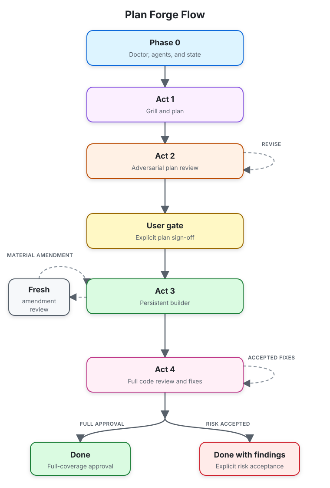

# Plan Forge Flow 0.58.0

Plan Forge Flow is a Codex, Claude Code, and Cursor plugin for decision-complete planning, fresh
adversarial review, controlled implementation, and final code review. It ships as an MCP server: a
typed .NET 10 executable named `planforge` that exposes twenty-one tools. Release 0.16.0 supports only
Windows x64.

The host agent is the orchestrator. It runs the interview and revises the plan between review
rounds, because it is the only participant holding the interview context. The Critic, Builder, and
Scout are separate model processes. Critic reviews and Builder implements against the plan; Scout is
a read-only bounded-reconnaissance process, and none of the three revises the plan.

Every Codex worker — Builder, Critic and Scout — runs without Codex's sandbox or approval prompts,
including resumed retries, with the launching process's permissions. Codex Critic and Scout stay
read-only by their contracts alone. `builderRoots` is accepted for compatibility and does not
restrict access.

A worker turn that tried commands and started none answered without reading the repository, so its
answer is not used: the act fails, quoting the vendor, and no review round is spent.

## Workflow



| Tool | What it does |
|---|---|
| `forge.begin` | Opens a run, takes a baseline of the working tree, and starts every vendor's catalogue probe in the background; reports configured and partly configured `advisors` |
| `forge.models` | Returns each vendor's model catalogue for the interview, newest first, with availability and the reason when a vendor is not usable, and the efforts each model offers at Fast speed |
| `forge.scout.select` | Lazily records an exact Scout Vendor/model/effort/Fast selection or an explicit decision to continue without Scout |
| `forge.scout.run` | Runs one bounded Scout question and returns its complete answer plus document metadata; the answer is also appended to `scout-answers.json` |
| `forge.evidence.map` | After the manual Evidence check, asks a configured Advisor how Scout items and Orchestrator implications bear on the plan; returns flags and resumable progress, storing judgments in `evidence-map.json` |
| `forge.instructions.set` | Records what the user wants this run's critic told and what they want its builder told, verbatim, for the acts to carry |
| `forge.plan.write` | Writes the first draft or a complete rewrite to `PLAN.md` and answers with its outline (null for blank plan text) and path, running no worker |
| `forge.plan.outline` | Returns the current plan hash and snapshot targets with IDs, kinds, labels, hashes and character sizes, without plan text beyond labels |
| `forge.plan.patch` | Revises selected targets against the exact outline hash; answers with the new outline, change summary, character and UTF-8 byte sizes, and document paths, running no worker |
| `forge.plan.review` | Applies typed plan decisions, then runs one round against the active plan-phase ledger projection |
| `forge.plan.show` | Renders `PLAN.md` as a document in hosts that negotiate the MCP Apps UI extension, with the drift beside it, and answers with its `planHash` |
| `forge.plan.confirm` | Approves `PLAN.md` as it stands, refusing it when `planHash` names another plan; applies final plan decisions on approval, refuses unresolved active plan IDs, then records approval and optional case-sensitive `fullGate=beforeNextRound\|final`; omission preserves timing/settings, explicit settings replace, empty settings clear. Approval resets the global gate failure, preserving attempts; approved false changes no PLAN/state/ledger or approval and accepts no decisions |
| `forge.build.next` | Builds one task; only the server runs its executable gate, withholds the task on failure and briefs the retry. The Builder checks conditions and may run separate checks |
| `forge.review.code` | One code-review round: a fresh critic judges the diff against the approved plan. Saved beforeNextRound refuses pending fixes; final permits them and returns current pending IDs (including []); assessments do not verify them. A prompt longer than the critic's vendor accepts gives the critic its files by path, untracked files first; one too long even then is refused before it starts, with its sizes, and `excludePaths` narrows that one round |
| `forge.review.fix` | Applies typed code decisions, including raises of the orchestrator's own, and optionally fixes exact ledger IDs under a retryable fix-attempt ID, with an optional note to the Builder, then runs executable G entries by default (`gate=full`) or only the approved Fix gate (`gate=targeted`), leaving findings pending full host verification. Retry preserves gate, attempt and exact IDs |
| `forge.status` | Reports saved `run.fullGate`, current pending IDs and covering attempts, plus a compact ledger summary with current IDs, dispositions and active phases, `run.scout` state, filtered drift, active-job liveness, and current configured and partly configured `advisors` |
| `forge.work.start` | On Cursor hosts, and elsewhere for a Builder act expected to outlast the hour, starts one worker act, including Scout, as a background job; optional gate is only for review.fix with fix IDs, with direct-call validation and immutable retry binding |
| `forge.work.poll` | Waits for a background worker act, 45 seconds per call or `waitSeconds` (at most 45 on Cursor, 3000 elsewhere, clamped and reported beyond that), returning as soon as it ends, and reports its latest stdout activity and recognised event |
| `forge.work.cancel` | Requests cancellation of a background worker act; terminal jobs are unchanged and running jobs finish as failed |
| `forge.work.fetch` | Fetches the historical terminal snapshot of a background worker act; status and new fix replay show current pending |
| `forge.log.append` | Appends one orchestrator entry to the run's diagnostic log; its optional `phase` declares the Orchestrator phase that begins, closing the open one and recording it in `telemetry.json` |

The draft the critic reads states its own intent: a `## Requirements` section above the tasks,
numbered and cited by the tasks that serve them, and the checks that would catch a requirement being
violated — a `Gate` ending each task, plus a `## Gates` section for whatever no single task owns.
Only the server runs an executable task gate, including on retries. The Builder checks conditions
and may run separate targeted checks; when it leaves verification to the server, it reports
`unavailable` with that explicit reason. The Orchestrator runs plan-wide gates before code review,
and the server runs their executable commands after full-mode review fixes. Before the first plan,
the interview asks once, in the conversation's language: full verification after each Builder fix
turn (`gate=full; fullGate=beforeNextRound`), or only at the end (`gate=targeted; fullGate=final`)?
The Brief records explicit parameters with its label in the plan's language. Targeted/beforeNextRound
is also supported by explicit choice, without a third mandatory question or repeated interview.

Targeted needs exactly one executable Fix gate in the first real `## Gates` section with real
numbered G entries; the plan Critic checks it before approval. In targeted mode the Orchestrator
runs all G1..Gn, conditions included, after the round's fixes before the next Critic by default,
or after code approval with final. Short success leaves persistent pending findings and attempts;
only successful full host verification closes them with `hostVerified` evidence. Record command,
covered attempts, exit code and output tail through `forge.log.append`; failure leaves fixes
unverified and the Orchestrator chooses repairs, raises or environment work without automatic
attribution. Pass failure output in the next fix note or raise. Do not repeat a successful full run
without edits; full-mode executable results may be reused, with conditions checked separately.

Read saved timing from status. A timing-only change explicitly reconfirms the same plan, without
plan.write or rewriting the initial Brief; later confirms omit fullGate until another explicit
user change, including approval after a future revision. Both gate/fullGate are case-sensitive;
empty, whitespace and unknown values are refused, including fullGate with approved false. Saved
malformed timing stops state reads unchanged: log the failure with log.append and start a new run,
without manual .forge edits. A new/nonterminal targeted fix validates its Fix gate before decisions
or jobs; terminal replay needs no valid gate in the current plan. Explicit gate without fix IDs is
refused; work.start accepts it only for review.fix.

Full verification is required before success at either timing. A user stop or declined extra round
ends an unfinished run with explicit pending IDs and attempts. Code repairs after final approval
return to fix → new Critic → full verification; when the cap refuses that round, first ask for an extra round.
Environment-only repairs repeat full checks without another Critic. Blocked beforeNextRound may
repair the environment, explicitly reconfirm final, or consciously defer/reject with an honest
unverified outcome. An unsuitable or broken short check can be bypassed with a new full-mode
attempt for a separate batch; changing a plan requires ordinary revision/review/approval.
Host result annotations use camelCase and are absent from model output schemas:

| Result | gateMode | pendingFullGateFindingIds |
|---|---|---|
| Task build or decisions-only fix | omitted | omitted |
| Full fix, including version-2 replay | full | omitted |
| Targeted fix or replay | targeted | current pending for that attempt, or [] |
| Code critique with saved final | omitted | current pending for the run, or [], including empty diff |
| Plan critique or code critique with beforeNextRound | omitted | omitted |

Only attempt.GateMode persists the mode; LastResult stores no host annotations. Direct and
background completion agree; fetch is historical, while fix replay and status recompute pending.

The requirements are under review beside the tasks, and only what they exclude is settled, so a plan
aimed at the wrong thing is a finding rather than a clean approve.

Both reviews are one round per call, because the orchestrator has to take a turn in between: it
revises the plan after `forge.plan.review` with a patch for some targets or a whole-draft write for
a rewrite before the next round, and after `forge.review.code` it filters the findings against the
approved plan before `forge.review.fix`
relays them. That turn is recorded rather than assumed — a plan-review round after the first is
refused without an account of what the previous one changed, and it lands in the flow log where the
user reads the two loops as a conversation. The critic and the builder never talk directly.
`decision-ledger.json` is the source of truth for monotonic finding IDs, current dispositions and
active phases; the Flow log is the complete human-readable audit and is never Worker input. See
[docs/adr/0005](docs/adr/0005-code-review-through-the-orchestrator.md) for why the sealed loop was
opened.

Plan review receives entries active in `plan_review`; code review receives settled plan decisions
plus entries active in `code_review`. A Critic assesses displayed unresolved IDs and may only
propose reopening a displayed deferred or rejected ID. The Orchestrator accepts or declines,
filters semantic duplicates with `duplicateOf`, and owns every disposition or closure. Plan
decisions travel through the next review or final approved confirmation. Code decisions and
host-verified closures travel through `forge.review.fix`; its Builder sees the verbatim findings for
the requested fix IDs only, followed by the orchestrator's `note` when it sends one. A decisions-only
`forge.review.fix` may also raise findings of the orchestrator's own — a place a fix left behind —
which take the next IDs and are assessed by the next Critic like any other. See
[docs/adr/0025](docs/adr/0025-fix-the-rule-not-the-place.md).

One `decisionBatchId` names one logical decision set. An exact retry is a no-op; a conflicting reuse
returns the saved result, and a new key is only for a new legal delta. Fix execution is separate:
one `fixAttemptId` names one exact sorted ID set and one immutable gate mode. Cut-short, retained and gate-failed executions
retry that same attempt, set and gate, while a completed retry returns its saved terminal result
with current pending annotations. Background fetch keeps its historical completion snapshot.

The plan is readable from the first round: `forge.plan.write` puts the first draft at `PLAN.md`
and returns its outline and document path before review starts. Later revisions use
`forge.plan.patch` for selected targets or `forge.plan.write` for a rewrite; each round reads the
complete document with `planDraft` omitted. A patch uses the current plan hash and each target's
ID and hash from `forge.plan.outline`. On a stale-base refusal, read the outline and redo the
edits against its current hash; never resend the refused patch unchanged. A replay after a lost
answer conflicts, and equal text is never proof of success.

A round, a whole-draft write or a patch after approval withdraws it and forgets the Builder session.
A whole-draft write, or a round handed a draft, also resets the build progress to zero. A patch
keeps every built task before the first task whose text it changes, with the files those tasks
changed for the next task's hand-over, and answers with `tasksKept` and `firstTaskOwed`; a patch to
the title, Requirements, Gates or an unbuilt task keeps them all. A re-approval keeps what the
revision kept, unless `forge.plan.confirm` is given `rebuildFrom`, a built task the user asks to
rebuild from. The Flow log names the cause and the tasks kept. The patch hash check and replacement
take no lock and are not atomic together. See
[docs/adr/0009](docs/adr/0009-the-plan-is-visible-from-the-first-round.md),
[docs/adr/0014](docs/adr/0014-writing-the-plan-is-its-own-call.md),
[docs/adr/0035](docs/adr/0035-patch-the-plan-against-a-snapshot-outline.md) and
[docs/adr/0039](docs/adr/0039-a-patch-keeps-the-built-tasks-it-does-not-change.md).

Approval does not go through MCP elicitation, and since 0.8.0 there is no code here that can ask the
user anything. The orchestrator reads the drift out of `forge.status`, shows the user the plan and
that drift however its own host shows things best, and passes back what they answered.
`forge.plan.confirm` records it. See
[docs/adr/0003](docs/adr/0003-approval-through-the-orchestrator.md) for why elicitation was removed
rather than repaired. The plan it approves is `PLAN.md` as it stands, named by the hash the user's
copy was shown at, rather than the whole text sent back; see
[docs/adr/0038](docs/adr/0038-approve-the-plan-on-disk-by-its-hash.md).

On a host that negotiates the MCP Apps UI extension — Cursor does, Claude Code does not — "however
its own host shows things best" has a concrete answer: `forge.plan.show` renders the plan as a
document, with the drift above it, in the host's own UI. It is display only, and every other host
sees the surface it always did. See
[docs/adr/0008](docs/adr/0008-render-the-plan-on-a-canvas.md).

The tool is for a decision the user actually made. Deciding on their behalf is the one thing it must
not be used for, and nothing in this codebase can tell the difference.

## Vendors

Three vendors can fill the Critic, Builder, or Scout role. Critic and Builder are chosen per call
with the `vendor` argument, while Scout persists its own selection: the critic's choice goes to the
two review tools, the builder's to `forge.build.next` and `forge.review.fix`, so the roles stay
independent:

| Vendor | Reached through | Structured output | Catalogue |
|---|---|---|---|
| `claude` | Claude Code CLI | `--json-schema`, natively | resolved, aliases through `init` |
| `codex` | Codex CLI, `codex exec` | `--output-schema`, natively | live, `codex debug models` |
| `cursor` | `cursor-agent` CLI | schema in the prompt, validated here | live, `--list-models` |

Structured output is a hard requirement of the vendor interface, so a vendor without native support
gets the schema in its prompt and one retry against our own validation. The catalogues feed the
interview: `forge.models` serves them so the model question offers what the vendor actually serves,
newest first, rather than the orchestrator's memory of the line-up. They remain advisory for
model and effort — the vendor CLI decides, and an unfamiliar model is a warning rather than a
refusal.

Speed is the exception. Each worker can run at its vendor's Fast tier — quicker, at a higher usage
price — where the catalogue lists it for that model and effort: codex's `priority` tier with its
price hint, cursor's `-fast` ids, and claude's fast mode where both the model and the account allow
it. A `fast` request the catalogue does not confirm is refused before any worker starts, and every
turn names its speed, so a Fast toggle in the vendor's own configuration never reaches a run.
Claude also refuses at the start of its session when the account will not serve Fast. When a Claude
turn falls back to standard speed part-way, the result carries `speedWarning`. See
[docs/adr/0023](docs/adr/0023-refuse-a-fast-request-nothing-confirmed.md).

Role prompts live in [`prompts/`](prompts) as plain markdown and can be edited without rebuilding
the binary — in a checkout. An installed plugin keeps them under its plugin root, where an edit
reaches every project and is lost on upgrade, so what a user wants said for one run goes through
`forge.instructions.set` instead. The shared [Roslyn contract](prompts/roslyn-contract.md) is
appended to every role's prompt; the [scope contract](prompts/scope-contract.md) is appended for
code review, where the Critic judges against the approved plan.

## Advisor and Evidence map

An Advisor is an external service answering typed Choice questions, with a probability for each
option. TypeSafe's Jev and Microsoft-Decision-1 in Azure AI Foundry are the implementations; both
speak the same systemone protocol. The optional Evidence map is shadow-mode
advice after the Orchestrator's mandatory manual Evidence check: code chooses the items and
candidate plan units, validates every answer and settles each item's status. A `covered` removes
nothing. The Orchestrator handles flags the manual check had not handled, calls again until
`complete` or until `checkedThisCall` is 0, and checks new unchecked items by hand if incomplete.
The map is never shown to the Critic, Builder or Scout and has no place in code review.

Once a Run has used the map, `forge.plan.write`, `forge.plan.patch` and `forge.plan.review` answer
with `evidenceMapWarning` when the plan has changed after a plan-review round that no complete map
call has followed; a round that runs so also gets a `## Evidence map not current` Flow-log entry.
A complete map records the plan hash it judged and the rounds run by then, so patches made in
answer to a map before its round draw no warning. Nothing is refused.

Configure an Advisor in the environment inherited by the server process. Jev, id `jev`:

| Variable | Meaning |
|---|---|
| `PLANFORGE_JEV_API_KEY` | Required secret; configuring it is consent to send excerpts from every repository forge runs in on that machine |
| `PLANFORGE_JEV_MODEL` | Optional pinned model, default `jev-1.13.0`; must match `^jev-\d+\.\d+\.\d+$`; `jev-latest` and `jev-preview` are invalid |

Microsoft-Decision-1, id `microsoft-decision`, authenticated by key; Entra ID is not supported:

| Variable | Meaning |
|---|---|
| `PLANFORGE_MSDECISION_ENDPOINT` | Required resource endpoint from the deployment's page, such as `https://<resource>.services.ai.azure.com`, or a gateway base; https, with no credentials, query or fragment. A Foundry project endpoint (`…/api/projects/…`) is invalid: its route demands an api-version the adapter does not send |
| `PLANFORGE_MSDECISION_API_KEY` | Required secret, sent in the `api-key` header; configuring it is the same consent as Jev's key |
| `PLANFORGE_MSDECISION_DEPLOYMENT` | Required deployment name, sent as the requested model, with no default: 1–64 letters, digits, `.`, `_` or `-`, starting with a letter or digit |

Unset, empty or whitespace values are unset. An Advisor is configured only when all required
variables are set and all set variables are valid. `forge.begin` and `forge.status` read the server
process environment at each call and report `advisors.configured` (id and model) and
`advisors.partlyConfigured` (id and variable names with missing/invalid problems), never credential
values.
A vendor's own variables do not configure an Advisor. With none configured there is no external
call and the Evidence check stays manual; with one the Orchestrator uses it, and with several it
asks once which to use and passes that id on each map call.

Requests send the text of Scout items and Orchestrator-derived implications, plan units, and
Change points, which may themselves quote code, to TypeSafe at
`https://api.typesafe.ai/v1/systemone` for Jev, and to `/providers/microsoft/v1/systemone` under the
configured endpoint for Microsoft-Decision-1. No repository file and no code around a locator is
read for sending: repository locators are resolved locally and only their window hashes enter cache
keys. External URLs are never fetched. The sensitive-content check guards the strings before
sending. Configuring an Advisor applies to every repository forge runs in on that machine, rather
than one Run. **TypeSafe's standard service is not zero-retention.** Microsoft-Decision-1 requests
are handled under the terms of your own Azure resource; Plan Forge asserts no retention policy for
them.

Microsoft-Decision-1 is paced by its deployment's request quota, which the service reports in its
`x-ratelimit-*` response headers. A server process starts at one request a second until the first
report, then spends the reported bucket at 90% of its refill rate, so a raised quota needs no
configuration. At 60 requests a minute a map of a few hundred requests takes several
`forge.evidence.map` calls. Measured on 2026-10-20 with calls 3 s apart: 100 requests in the first,
43 in each of the next two, and no 429; the few still waiting for quota when a call ends are
cancelled and asked again by the next call. Only a refusal whose body blames the request is
remembered: an unsupported question as `rejected`, a token-limit refusal as `too_large`. An unknown
deployment or a wrong endpoint (404), a bare 413 or 422 a gateway could send, and any other refusal
stay `unavailable` and are asked again once the configuration is fixed; the endpoint is not part of
a cache key, while the deployment name is. The service reports the unversioned `microsoft-decision-1`
as its model, so a model change behind a deployment does not by itself invalidate stored
judgments: pin the model version in the deployment, and to re-ask, use another deployment name or
delete `evidence-map.json`.

The credential is read only from the environment when needed, stays in the server process, and
is never a tool argument or result, exception message, log, telemetry record or persisted Run
content. `forge.plan.confirm` refuses the gate-environment names `PLANFORGE_JEV_API_KEY` and
`PLANFORGE_MSDECISION_API_KEY`, ignoring case, naming only the variable. Child processes — Vendor
CLIs, catalogue probes, gates and git — have all Advisor secret variables removed after environment
overlays, even when an overlay names them. Other variables, including `PLANFORGE_JEV_MODEL`,
`PLANFORGE_MSDECISION_ENDPOINT` and `PLANFORGE_MSDECISION_DEPLOYMENT`, still reach children. The loopback-only
Telemetry collector is Plan Forge itself, starts no process and retains its environment. State
written before 0.50.0 is not inspected or rewritten for this rule.

The default tests use a sanitized, hand-labelled fixture and a fake Advisor, without network.
Each label keeps the fake's script (its answers, including refusals and abstentions written only to
reach the unchecked and uncertain paths, and the status they settle to) apart from the semantic
truth (the status and obligations a correct Advisor should reach). The default tests check the
script; the live evaluation measures against the truth.
To opt into the live evaluation, configure the Advisor in the test process environment as above,
then run its test from the monorepo root under pwsh 7 — `Evaluate_sanitized_fixture_with_configured_Jev`
for Jev, as here, or `Evaluate_sanitized_fixture_with_configured_Microsoft_Decision`:

```powershell
dotnet test plugins/plan-forge-flow/src/PlanForgeFlow.sln --nologo --disable-build-servers -nodeReuse:false --filter "FullyQualifiedName~EvidenceMapLiveEvaluationTests.Evaluate_sanitized_fixture_with_configured_Jev&Category=Integration" --logger "console;verbosity=detailed" *> $env:TEMP/planforge-evidence-evaluation.log
Get-Content $env:TEMP/planforge-evidence-evaluation.log -Tail 50
```

This deliberately calls the real service and costs money; without the key it fails naming the
variable. It resumes each of two fixture plans until complete or no progress and reports pooled
candidate recall, obligation recall, false coverage, abstentions, unchecked share, locator validity,
latency p50/p90, input/output tokens, completion and estimated cost, with no quality threshold.
For Microsoft-Decision-1 the latencies include the time a request waited for its quota.
Cost uses USD 0.042 per million input tokens, the price published for `jev-1.13.0` (2026-10-19)
and for Microsoft-Decision-1 (2026-10-09); output is free for Jev and unpriced for Microsoft;
missing usage or a ratio with no denominator is reported as null. Test output includes one line per
map call (requests, failed requests, judgments checked, duration), the JSON report and its
temporary-file path. See [ADR 0036](docs/adr/0036-advise-the-evidence-check-through-a-configured-advisor.md)
and [ADR 0037](docs/adr/0037-keep-the-scout-report-as-json-only.md).

## Requirements

- Codex, Claude Code 2.1.232 or newer, or Cursor 3.15.6 or newer
- Windows x64
- Git, and a Git repository for the target change
- The CLI of whichever vendor you select for a role
- .NET 10 SDK only when building from source
- Access to github.com on the first launch of a version, when the launcher downloads the executable

The distributed executable is self-contained, trimmed, and single-file; no preinstalled .NET runtime
is needed. Node.js is no longer required — the hooks that needed it are gone.

## Installation

The public repository is the marketplace. Install the plugin:

```text
codex plugin marketplace add <owner>/<repository>
codex plugin add plan-forge-flow@dlin10-codex-plugins
```

In Claude Code, add the same marketplace and install its Claude plugin:

```text
/plugin marketplace add <owner>/<repository>
/plugin install plan-forge-flow@dlin10-ai-coding-plugins
```

The installed plugin is small:

```text
plugins/plan-forge-flow/
  .codex-plugin/plugin.json
  .claude-plugin/plugin.json
  .cursor-plugin/plugin.json
  .mcp.json
  bin/planforge-launcher.cmd
  hooks/claude.pff.hooks.json
  hooks/codex.pff.hooks.json
  prompts/
  skills/forge/SKILL.md
  skills/forge/references/
```

`skills/forge/SKILL.md` is the skill's core — the participants, the phases, every tool's arguments —
and each phase is written down in its own file under `references/`, read when the phase begins, so
the core stays within what Claude Code re-injects after a context compaction. After a compaction,
a hook runs `planforge.exe --resume-card`, which prints where the session's run stands and the exact
shapes of the calls ahead into the compacted context: `hooks/claude.pff.hooks.json` on Claude Code,
`hooks/codex.pff.hooks.json` on Codex. Codex runs a plugin's hook only once you have trusted it — open `/hooks`
in Codex after installing or updating the plugin and trust the plan-forge-flow `SessionStart` hook.
Cursor runs no hook. See
[`docs/adr/0040`](docs/adr/0040-resume-the-orchestrator-after-a-compaction.md).

The executable is not in the repository. On launch, `bin/planforge-launcher.cmd` runs a locally
built `bin/win-x64/planforge.exe` when one exists, and otherwise the copy cached under
`%LOCALAPPDATA%\plan-forge-flow` for the manifest version. When neither is there it downloads
`planforge.exe` from the matching GitHub release into that cache with `curl.exe` — once per version
rather than once per session, and with no interpreter of the plugin's own: the launcher is a batch
file because a host starts it for every session and it then stays alive as the server's parent,
where `cmd.exe` holds under 10 MB of working set and `powershell.exe` around 50.

## State

Everything a run knows lives under one folder, isolated by run id, in the directory your host says
you are working in — so the plan and the timeline sit beside your session and your host can link
them, even when the run is reviewing a repository root several levels above. A host that does not
tell the server where you are (today: Codex and Cursor) gets the folder under `workspaceRoot`
instead.

```text
.forge/
  .gitignore            # contains "*" — the folder ignores itself
  <runId>/
    state.json
    decision-ledger.json    # authoritative current finding state and idempotency records
    PLAN.md               # the plan as it currently stands, rewritten before every review round
    scout-answers.json    # the only Scout report: numbered answers with stable item IDs and locator checks
    evidence-map.json     # content-addressed judgments, the last complete map and latest call result
    flow_log.md           # the user-facing audit; never Worker input
    forge.log
    telemetry.json        # Worker, Orchestrator-phase and Advisor usage; three record kinds
    orchestrator-phase.json   # the open Orchestrator phase, so a later server process can close it
    baseline.patch
```

`PLAN.md`, `flow_log.md`, `scout-answers.json`, `evidence-map.json`, `decision-ledger.json` and the
indented `telemetry.json` are human-readable. The tools hand back the plan and timeline paths on worker results, and hand back Scout
metadata only after a successful Scout call, so the orchestrator can put the current documents in
front of you while the run is still moving; telemetry stays at the stable Run path and adds no MCP
result.

Each telemetry entry's `at` is its opening in local time, formatted as `yyyy-MM-dd HH:mm:ss`:
the Worker process start, Orchestrator phase opening or Evidence map call start. Records are written
on completion and inserted in opening order. For Worker records, `wallDuration` is the process
lifetime, `toolDuration` is the union of its observed tool-use/result intervals, and `duration` is their difference: time outside tool calls, including
API waits. Parallel calls count once. A background command contributes only until its tool call
returns, even if the command keeps running. Tool intervals use the server's monotonic clock when
stream events arrive and are bounded by the process lifetime; stream buffering can affect them.
Without tool boundaries, or with missing IDs or unmatched boundaries, `toolDuration` is explicitly
`null` and `duration` equals `wallDuration`. Durations use `hh:mm:ss`, with total hours unbounded;
wall and tool times are truncated to seconds before subtraction so the displayed values add up.
The ISO timestamps in `forge.log` retain their existing meaning and format.

In telemetry, `inputTokens` is the complete input processed by the Worker attempt, including cache
reads and cache creation. `cacheReadTokens` and `cacheCreationTokens` are optional subsets of that
total and must not be added to it. Likewise, `outputTokens` is the complete output count and
`reasoningTokens` is an optional subset of it. `costUsd` is the price Claude reports for the attempt
(`total_cost_usd`); Codex and Cursor report none, so their records carry no `costUsd`.

Every counter is the attempt's own, including on a resumed Builder or Scout session. Codex reports
its tokens, and Claude its tokens and cost, as a running total for the whole session, so a resumed
attempt records what that total grew by and keeps the reported total in `sessionTotal`. Claude's
tokens include what the Worker's subagents and context compaction used.

### The Orchestrator's records

The file holds three kinds of record: `vendor.usage`, one per Worker attempt, as above,
`orchestrator.usage`, one per Orchestrator phase, and `advisor.usage`, one per accepted Evidence
map call. An Advisor record holds requested and served model, request/failure and judgment counts,
reported tokens, cache hits, latency p50/p90, duration, completion and stop reason, with no content.
Each such call also attempts one content-free `## Evidence map` entry in `flow_log.md`, including on
cancellation or failure. Neither record changes the map's outcome if its own write fails.

`forge.begin` opens the `interview` phase, and
the Orchestrator declares each later one — `planning`, `plan_revision`, `approval`, `build`,
`code_review`, `wrap_up` — through the `phase` argument of `forge.log.append` when it begins it;
`done` closes the last. Each declaration closes the open phase and writes its record. The open
phase is kept in `orchestrator-phase.json`, so a phase opened before a host restart is closed by the
next server process. A phase never closed has no record, and a missed declaration only makes the
records less accurate.

Records stand in the order they opened, whichever kind they are: a record goes after the last one
whose `at` is no later, not at the end of the file. A phase closes when the next is declared, so it
is written after the records of the Workers that began inside it — `plan_revision` after the Critic's
next round — and is placed before them, where it opened. An element without a text `at` is a
boundary the record is not moved past, and an element already in the file is never moved.

An `orchestrator.usage` record carries, absent values omitted:

- `at`, the phase's opening in local time, `phase`, and where the run stood: `round` for
  `plan_revision` and `code_review`, `taskNumber` and `taskCount` for `build`;
- `host`, the MCP client's name, `hostSessionId` and `usageSource` (`telemetry` or `transcript`);
- `wallDuration`, the phase's length; `toolDuration`, the time inside Plan Forge's own tool calls
  of the run, overlapping calls counted once; and `duration`, their difference: the Orchestrator's
  own time, waits for the user included. All three are `hh:mm:ss`;
- the token counters, normalized as for Workers: `inputTokens` with its `cacheReadTokens` and
  `cacheCreationTokens` subsets, `outputTokens` with its `reasoningTokens` subset, and `costUsd`
  where the telemetry export reports it;
- `usageIncomplete: true` when the counters may be short — the Host session changed during the
  phase, the collector began covering the session after the phase opened, a counter was malformed
  — and `usageMissing` when there are no counters at all: `no_host_session`, `source_failed` or
  `no_telemetry_events`.

The Host session is what the counters are read for. Under Claude Code it is the session the server
was started for (`CLAUDE_CODE_SESSION_ID`); under Codex it is the thread its tool calls name
(`_meta.threadId`). Cursor gives the server neither, so a host with no Host session gets time only,
with `usageMissing: "no_host_session"`.

The tokens come from one of two Usage sources, chosen once per server process when its Host session
first becomes known and written to `forge.log`:

- **The telemetry export**, when the host's own profile sends OpenTelemetry logs as OTLP/JSON over
  HTTP to a loopback endpoint ending in `/v1/logs`. Plan Forge starts a Telemetry collector on that
  port — `planforge.exe` in a second mode, shared by every server pointed at it — which keeps only
  the API-request events of the sessions servers registered with it, and only their usage fields:
  never a prompt or an account. Under Claude Code it sees every model request of the session, the
  Orchestrator's subagents included, and Claude's reported cost; under Codex it sees the
  Orchestrator's own thread only, since a Codex subagent runs in a thread of its own that no server
  registers. A response counts in the phase it began in, because both hosts stamp it when the
  response ends, after they have already run the tool call that response made: a Claude request at
  its event time less its `duration_ms`, a Codex response at the time of its thread's latest request
  start before it (`codex.websocket_request`, or `codex.api_request` less its `duration_ms`), or at
  its own time when there is none; of a request start the collector keeps only its time. Before reading a
  phase it waits the host's export interval plus a second — Claude's `OTEL_LOGS_EXPORT_INTERVAL`,
  5 s by default and at most 10 s; Codex 5 s.
- **The transcript** otherwise: Claude Code's session `.jsonl` and its subagents' files, each
  response counted once, in the phase of its earliest line, or the Codex thread's rollout file, as
  the growth of its running total.
  It carries no cost. Before reading a phase it waits 2 s for the host to finish writing.

A source that fails leaves the counters absent with `usageMissing: "source_failed"` and a `warn`
entry in `forge.log`; it never changes a tool's result.

The collector is started outside the host's Windows job object where that job object permits it.
Under a host whose job object refuses breakaway, such as Claude desktop, Codex desktop and
`codex exec`, it runs inside that job object instead and ends with it, taking what it held — under a
job object that ends its processes when its last handle closes, as `codex exec`'s does, that is when
the host's session ends. The next phase opening of a server that chose the export starts it again,
and that restart is logged. The choice entry and the restart entry say whether the collector runs
inside the job object and whether that job object ends it on close.

To turn the export on for Claude Code, add the `env` keys to `settings.json` in your Claude config
directory (`CLAUDE_CONFIG_DIR`, else `%USERPROFILE%\.claude`), merging them into an `env` object
already there. Pick any free loopback port; 47318 here:

```json
{
  "env": {
    "CLAUDE_CODE_ENABLE_TELEMETRY": "1",
    "OTEL_LOGS_EXPORTER": "otlp",
    "OTEL_EXPORTER_OTLP_LOGS_PROTOCOL": "http/json",
    "OTEL_EXPORTER_OTLP_LOGS_ENDPOINT": "http://127.0.0.1:47318/v1/logs"
  }
}
```

For Codex, add the `[otel]` table to `config.toml` in Codex's home (`CODEX_HOME`, else
`%USERPROFILE%\.codex`). The exporter must stay on one line, or be written as an
`[otel.exporter.otlp-http]` table with the same two keys:

```toml
[otel]
exporter = { otlp-http = { endpoint = "http://127.0.0.1:47318/v1/logs", protocol = "json" } }
```

Only these files are read. Settings given in the shell environment, in managed settings or through
`--settings` are not seen, and the run then reads the transcript. Restart the host after the change:
the host reads its profile when it starts, and each server process chooses its source only once. Workers export too when the profile is on; the collector
drops their events.

Approval is not the file's existence — it is `approved` in `state.json`, and a review round run
after an approval takes that flag back.

There are no locks: concurrent runs in one workspace are allowed. There are no Git refs: the
baseline is a commit SHA in `state.json` plus `baseline.patch`.

## What is checked, and what is not

Two checks survive, both against irreversible harm:

- **Secrets leaving for another model.** Every prompt is inspected before it is handed to a vendor,
  and a sensitive path is refused by name across the set that is actually sent — the same pathspec
  the diff uses, so a sensitive name under an excluded documentation path is not refused, because
  its contents never leave. Workers run in the workspace and can still read files omitted from the
  filtered diff; see [`docs/adr/0004`](docs/adr/0004-documentation-written-during-the-interview.md).
- **Writes staying inside the run.** One containment test on the run id, instead of six guards.

- **A task's gate, where it is a command.** After every builder turn the server runs the command
  that follows `**Gate:**` on the host — with the environment the approval carried — and a non-zero
  exit withholds the task as `gate_failed` and hands the output to the builder's retry. The
  builder's own `verification` decides only where the gate is a condition rather than a command.
  See [`docs/adr/0015`](docs/adr/0015-the-host-runs-the-gate.md).

Everything else is observable rather than prevented. No hook gates anything — the resume card's
hooks only read the run — so an orchestrator can abandon a run midway or start editing during the interview. Filtered drift since
`forge.begin` is reported by `forge.status`, excluding `CONTEXT.md` and `docs/adr/**`, so it is
visible to whoever looks — and approval itself is an assertion by the orchestrator that it asked.
These are deliberate trades, recorded in
[`docs/adr/0002`](docs/adr/0002-mcp-server-surface-without-enforcement.md) and
[`docs/adr/0003`](docs/adr/0003-approval-through-the-orchestrator.md), with the documentation boundary
in [`docs/adr/0004`](docs/adr/0004-documentation-written-during-the-interview.md).

## Development

```text
src/PlanForgeFlow.sln
src/PlanForge/
src/PlanForge.Tests/
```

Run the solution from `plugins/plan-forge-flow`:

```text
dotnet test src/PlanForgeFlow.sln --filter "Category!=Integration"
```

Integration tests drive the real vendor CLIs and cost money, so they are traited out of the default
run. `build/package.ps1` publishes `win-x64`, verifies the published binary by completing an MCP
handshake against it, refreshes `bin/win-x64/planforge.exe` with `-InstallBinaries`, and creates the
marketplace archive. Packaging fails if the publish directory contains any sidecar file.

[`CONTEXT.md`](CONTEXT.md) holds the vocabulary and the measured facts behind the design.

## Attribution

The Act 1 interview derives from Matt Pocock's MIT-licensed `grill-me` prompt. See
[THIRD-PARTY-NOTICES.md](THIRD-PARTY-NOTICES.md). The plugin is distributed under the
[MIT License](LICENSE).
